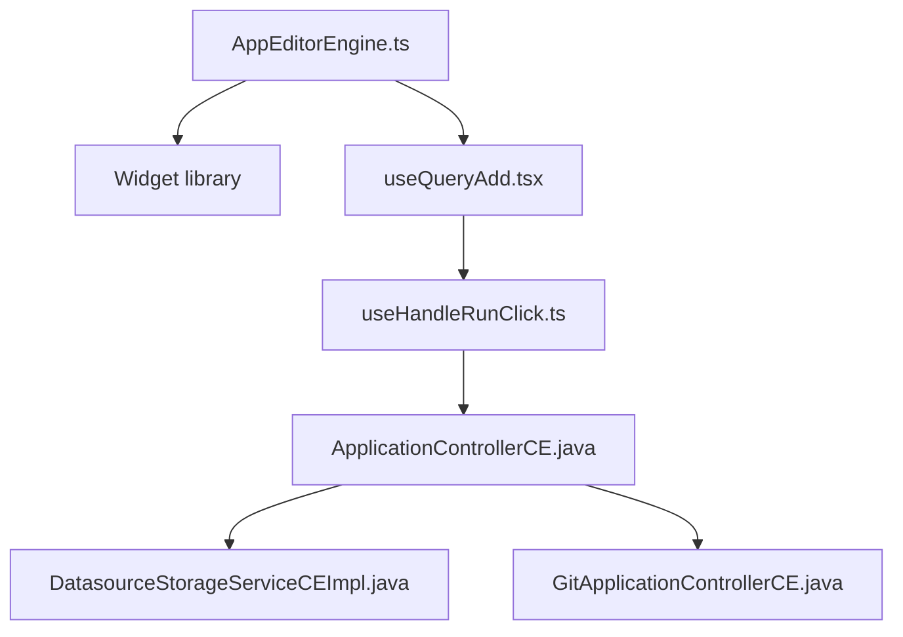

# appsmithorg/appsmith

> Plateforme low-code open source pour construire des tableaux de bord et outils internes.

## Le problème
Les équipes ont besoin d'outils internes (admin, tableaux de bord) sans les développer entièrement.

## Ce que ça fait vraiment
Éditeur visuel de widgets, connexion à des sources de données et requêtes, workflows Git, import/export d'applications. Serveur Java avec plugins ; le README promeut aussi « Appsmith Agents », une offre d'agents IA.

## Comment c'est branché

## Essayer
Aucune commande dans le README : installation via les guides de la documentation (Docker recommandé, Kubernetes, AWS AMI) ou Appsmith Cloud.

## Coût et pièges
Auto-hébergement gratuit ; Appsmith Cloud et Agents sont des offres de l'éditeur. 4 527 issues ouvertes.

## Ce que ce n'est pas
Pas du no-code total : requêtes et JavaScript restent nécessaires. Les liens serveur du diagramme sont non vérifiés.

## Alternatives
Aucune alternative nommée dans le README.

## Pour toi
À surveiller : pratique pour monter une interface sur des données ou un modèle sans front dédié, mais lourd à héberger.

