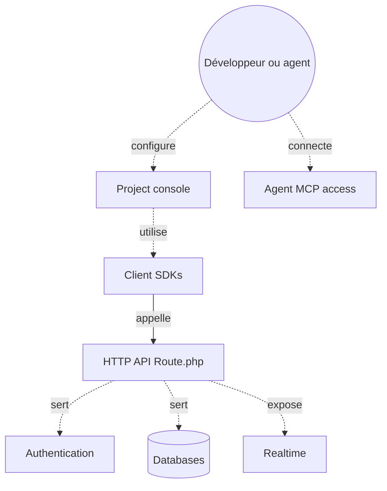

# appwrite/appwrite

> Self-hosted backend platform (authentication, databases, files, functions) with an MCP server for agents.

## The problem
Implementing authentication, storage, databases, and notifications for each application takes time before the first feature is even available.

## What it actually does
A modular backend: Auth, Databases, Storage, Functions, Sites, Messaging, Realtime, and Firewall, exposed via REST, GraphQL, and WebSocket. An SDK is available for around 20 client and server-side languages. A hosted MCP server (OAuth) allows Cursor or Claude Code to interact with a live project. The architecture combines a monolithic and micro-services approach with workers on a message queue.

## How it is wired


## Trying it
```bash
docker run -it --rm \
    --publish 127.0.0.1:20080:20080 \
    --volume /var/run/docker.sock:/var/run/docker.sock \
    --volume "$(pwd)"/appwrite:/usr/src/code/appwrite:rw \
    --entrypoint="install" \
    appwrite/appwrite:2.7.1
```

## Cost and gotchas
Docker is required, with access to its socket. The installation assistant listens locally and prints a one-time use secret. The managed cloud offers a free tier, followed by paid tiers.

## What it is not
This is not a data or MLOps platform; it is an application backend. The hosted MCP is cloud-based; for self-hosted, you need a local MCP server.

## Alternatives
No alternative is specified in the README.

## For you
This is not suitable for data/AI work: it is a backend for web and mobile applications, and is only useful if you build an application around your models.
