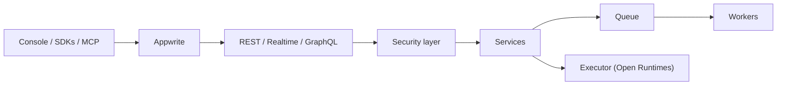

# appwrite/appwrite

> Plateforme backend open source (auth, bases, stockage, fonctions) pour développeurs et agents IA, via MCP.

## Le problème
Monter un backend complet (authentification, base, fichiers, fonctions, messagerie) pour chaque application est long.

## Ce que ça fait vraiment
Services : Auth, Databases, Storage, Functions, Sites, Messaging, Firewall, Realtime. API REST, GraphQL et WebSocket derrière une couche de sécurité ; les tâches lourdes passent par des files et workers. Un serveur MCP hébergé (OAuth) permet à Cursor, Claude Code ou Codex d'agir sur un projet réel. SDK client et serveur pour de nombreux langages.

## Comment c'est branché


## Essayer
```bash
docker run -it --rm \
    --publish 127.0.0.1:20080:20080 \
    --volume /var/run/docker.sock:/var/run/docker.sock \
    --volume "$(pwd)"/appwrite:/usr/src/code/appwrite:rw \
    --entrypoint="install" \
    appwrite/appwrite:2.6.1
npx skills add appwrite/agent-skills
```

## Coût et pièges
Cloud avec offre gratuite puis plans payants ; auto-hébergement gratuit (BSD-3-Clause). L'installateur monte le socket Docker de l'hôte : à bien cadrer. Le MCP hébergé ne s'applique pas à une instance auto-hébergée, qui utilise le serveur local.

## Ce que ce n'est pas
Pas un simple outil de base de données : plateforme complète, avec les contraintes d'exploitation associées.

## Alternatives
Aucune alternative nommée dans le README.

## Pour toi
À surveiller : utile pour prototyper un backend d'application IA avec accès par agents, à tester avant adoption.

