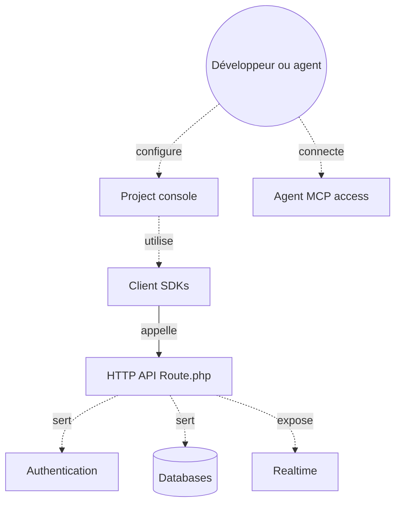

# appwrite/appwrite

> Plateforme backend auto-hébergeable (auth, bases, fichiers, fonctions) avec serveur MCP pour agents.

## Le problème
Monter pour chaque application l'authentification, le stockage, les bases et les notifications fait perdre du temps avant la première fonctionnalité.

## Ce que ça fait vraiment
Un backend modulaire : Auth, Databases, Storage, Functions, Sites, Messaging, Realtime et Firewall, exposés en REST, GraphQL et WebSocket. SDK pour une vingtaine de langages côté client et serveur. Un serveur MCP hébergé (OAuth) permet à Cursor ou Claude Code d'agir sur un projet vivant. Architecture hybride monolithe et micro-services avec workers sur file de messages.

## Comment c'est branché


## Essayer
```bash
docker run -it --rm \
    --publish 127.0.0.1:20080:20080 \
    --volume /var/run/docker.sock:/var/run/docker.sock \
    --volume "$(pwd)"/appwrite:/usr/src/code/appwrite:rw \
    --entrypoint="install" \
    appwrite/appwrite:2.7.1
```

## Coût et pièges
Docker obligatoire, avec accès à son socket. L'assistant d'installation écoute en local et imprime un secret à usage unique. Le cloud géré a un forfait gratuit puis des paliers payants.

## Ce que ce n'est pas
Ce n'est pas une plateforme de données ni de MLOps : c'est un backend d'application. Le MCP hébergé est lié au cloud ; en auto-hébergé, il faut le serveur MCP local.

## Alternatives
Aucune alternative nommée dans le README.

## Pour toi
À ignorer pour un travail data/IA : c'est un backend d'applications web et mobiles, utile seulement si tu livres une application autour de tes modèles.

