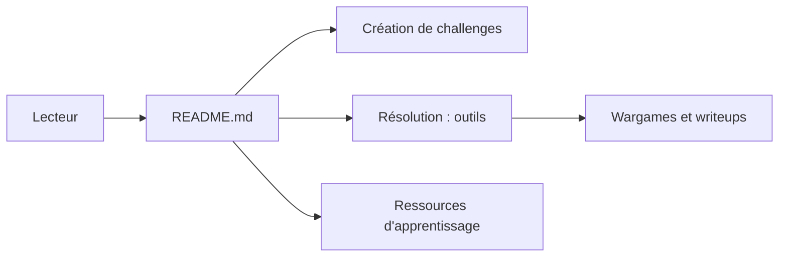

# apsdehal/awesome-ctf

> Annotated list of tools, platforms and resources for creating and solving CTF challenges.

## The problem
CTF tools are scattered; it is hard to know which ones to use per category.

## What it actually does
A Markdown README sorted into three blocks: create (platforms such as CTFd, FBCTF), solve (crypto, forensics, steganography, reverse engineering, web, network, exploits, brute force) and resources (security operating systems, tutorials, wargames, wikis, writeup collections). No application code.

## How it is wired


## Trying it
No command specific to the repository: read the README. The README occasionally gives tool installation commands, for example:
```bash
apt-get install foremost
pip install sqlmap
```

## Cost and gotchas
Free. Some of the platforms cited are paid (PentesterLab). Last push in July 2024: some links may be dead.

## What it is not
Not a tool or a course: a directory of links, with no guarantee of being up to date. Use of offensive tools remains subject to authorization.

## Alternatives
- CTF Field Guide (Trail of Bits): guide cited in the README for getting started.
- CTF Time: calendar of competitions.

## For you
Ignore: off-topic for data/AI/MLOps, unless you are training in security.
