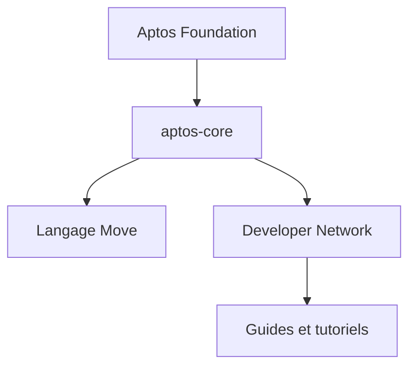

# aptos-labs/aptos-core

> Code of the Aptos layer-1 blockchain, written in the Move language, for Web3 developers.

## The problem
The README does not describe a specific problem; it points to external sites.

## What it actually does
Core repository of Aptos, a layer-1 blockchain centered on Move. The README says nothing more: links to the Aptos Foundation, the developer network, guides and tutorials. Undocumented.

## How it is wired
Simplified diagram based on the sheet, no diagram provided.

## Trying it
No documented command.

## Cost and gotchas
Not documented in the README. A license is present but not identified by GitHub.

## What it is not
Not an application SDK: it is the code of the chain itself. The README is too short to judge the rest.

## Alternatives
No alternative named in the README.

## For you
Ignore: a blockchain unrelated to data, AI or MLOps work, and the README is too thin to conclude otherwise.
