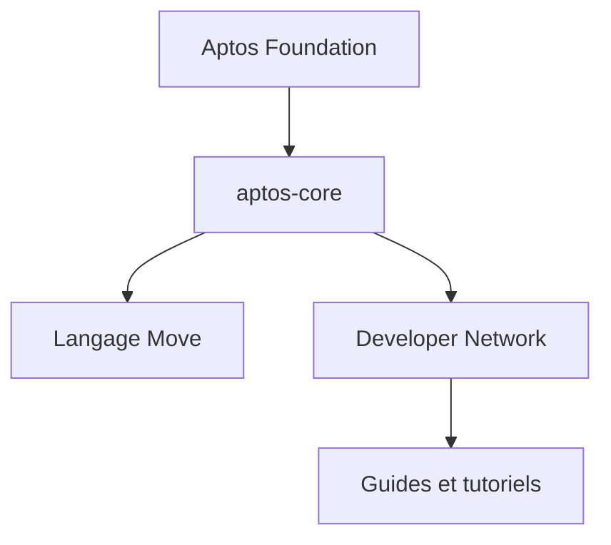

# aptos-labs/aptos-core

> Code de la blockchain de couche 1 Aptos, écrite avec le langage Move, pour développeurs Web3.

## Le problème
Le README ne décrit pas de problème précis, il renvoie aux sites externes.

## Ce que ça fait vraiment
Dépôt cœur d'Aptos, une blockchain de couche 1 centrée sur Move. Le README ne dit rien de plus : liens vers l'Aptos Foundation, le réseau de développeurs, des guides et tutoriels. Non documenté.

## Comment c'est branché
Schéma simplifié d'après la fiche, sans diagramme fourni.

## Essayer
Aucune commande documentée.

## Coût et pièges
Non documenté dans le README. Licence présente mais non identifiée par GitHub.

## Ce que ce n'est pas
Ce n'est pas un SDK d'application : c'est le code de la chaîne elle-même. Le README est trop court pour juger du reste.

## Alternatives
Aucune alternative nommée dans le README.

## Pour toi
À ignorer : blockchain sans lien avec le travail data, IA ou MLOps, et README trop mince pour trancher autrement.

