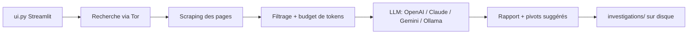

# apurvsinghgautam/robin

> Dark web OSINT tool: search through Tor, scraping and LLM synthesis, in a Streamlit UI.

## The problem
A dark web search produces many noisy pages; sorting them by hand takes a long time, and a naive
automatic summary synthesizes anything, even when there is nothing to say.

## What it actually does
Cleanly separates search, scraping and the model call. Models are discovered from each provider at
startup, so the list never goes stale. The sidebar sets the depth (number of filtered results,
number of scraped pages, and the share of each page read by the model) while showing the token cost
**before** launching. Follow-up questions are answered from the investigation data, without
re-running the search, and suggested pivots start a new investigation in one click. Investigations
are saved to disk and can be reloaded.

## How it is wired


## Trying it
```bash
docker pull apurvsg/robin:latest
docker run --rm -v "$(pwd)/.env:/app/.env" --add-host=host.docker.internal:host-gateway -p 8501:8501 apurvsg/robin:latest
pip install -r requirements.txt
streamlit run ui.py
OLLAMA_HOST=0.0.0.0 ollama serve &
```

## Cost and gotchas
Tor must be running in the background (`apt install tor` or `brew install tor`). One key is enough
among `OPENAI_API_KEY`, `ANTHROPIC_API_KEY`, `GOOGLE_API_KEY`, `MISTRAL_API_KEY`,
`OPENROUTER_API_KEY`, and the token bill is yours. With Ollama in a container, you must make it
listen on `0.0.0.0`: by default it binds to `127.0.0.1`, unreachable from Docker. Python 3.10+.

## What it is not
Explicit README warning: educational and lawful investigation use only; accessing some content may
be illegal depending on the jurisdiction, and the author disclaims all responsibility. Also beware
of sensitive queries sent to third-party APIs.

## Alternatives
No alternative named in the README.

## For you
A good example of budgeted RAG architecture; real use requires an explicit legal framework.
