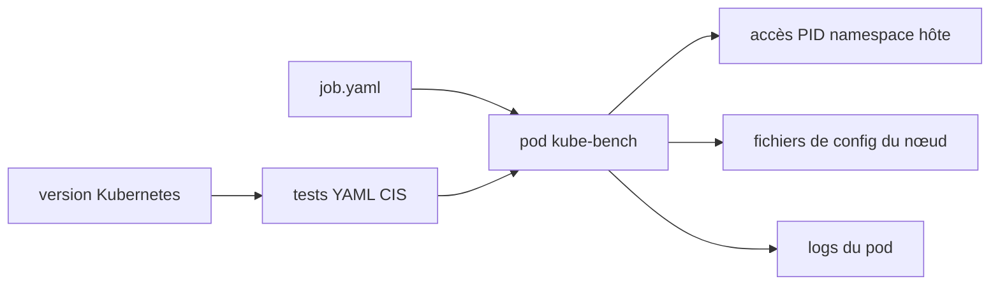

# aquasecurity/kube-bench

> Checks that a Kubernetes cluster complies with the CIS Kubernetes Benchmark, tests described in YAML.

## The problem
Manually checking the dozens of CIS Benchmark controls on each node is slow, and the result is neither reproducible nor versionable.

## What it actually does
Runs the controls documented in the CIS Kubernetes Benchmark against a cluster.
The tests are described in YAML, so they can be modified when the specification evolves.
By default, determines the test set to run based on the detected Kubernetes version.
Runs as a Kubernetes Job via the provided `job.yaml`, with results going out in the pod logs.

## How it is wired


## Trying it
```bash
kubectl apply -f job.yaml
kubectl get pods
kubectl logs kube-bench-j76s9
```

## Cost and gotchas
Free. The pod needs access to the host's PID namespace to inspect processes, and to several node directories: it is a privileged pod, to be treated as such.

## What it is not
Not a fixer: it reports, it does not remediate. Not aligned one to one with Kubernetes versions — the mapping between Kubernetes releases and benchmark releases is indirect, to be looked up. Not the arbiter of the benchmark: disagreements about a test's relevance go to the CIS community, not here.

## Alternatives
Trivy and the Trivy Operator — cited in the README as also covering the CIS Kubernetes scan, among other functions.

## For you
The baseline check to run on any cluster you operate, including a training cluster.
