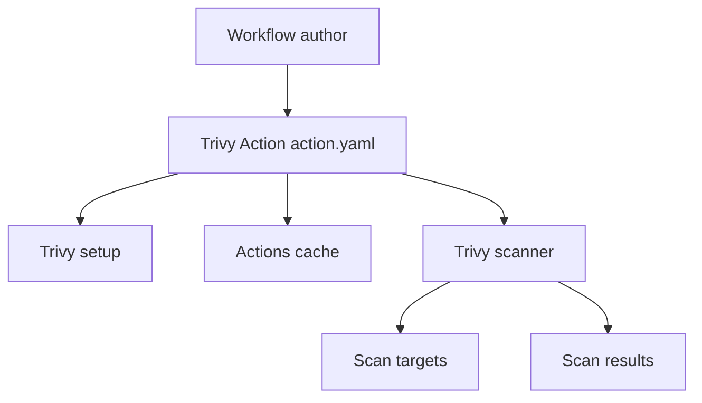

# aquasecurity/trivy-action

> GitHub Action that runs the Trivy scanner on images, repositories, IaC and SBOMs in a CI pipeline.

## The problem
Plugging a vulnerability scanner into CI requires installing Trivy, managing its database cache and publishing the results.

## What it actually does
The action installs Trivy via `aquasecurity/setup-trivy`, restores and saves the vulnerability database cache, then runs the scan: image, filesystem, repository, rootfs, IaC configuration, tar archive. It outputs in table, JSON, SARIF (GitHub's Security tab), template or SBOM format to the Dependency Graph. Options are passed through `with`, environment variables or a `trivy.yaml` file.

## How it is wired
Based on the provided diagram.



## Trying it
```yaml
- name: Run Trivy vulnerability scanner
  uses: aquasecurity/trivy-action@v0.36.0
  with:
    image-ref: 'docker.io/my-organization/my-app:${{ github.sha }}'
    format: 'table'
    exit-code: '1'
    ignore-unfixed: true
    vuln-type: 'os,library'
    severity: 'CRITICAL,HIGH'
```

## Cost and gotchas
Free. Keep the cache enabled to avoid rate limiting. Private registries require credentials in environment variables. SARIF upload requires the `security-events: write` permission.

## What it is not
Not the scanner itself: it is its GitHub Actions wrapper. The README does not describe the contents of `entrypoint.sh`, so nothing is established about its internal workings.

## Alternatives
No alternative named in the README.

## For you
Adopt: a simple step to scan the Docker images of your MLOps pipelines, with readable results in the Security tab.
