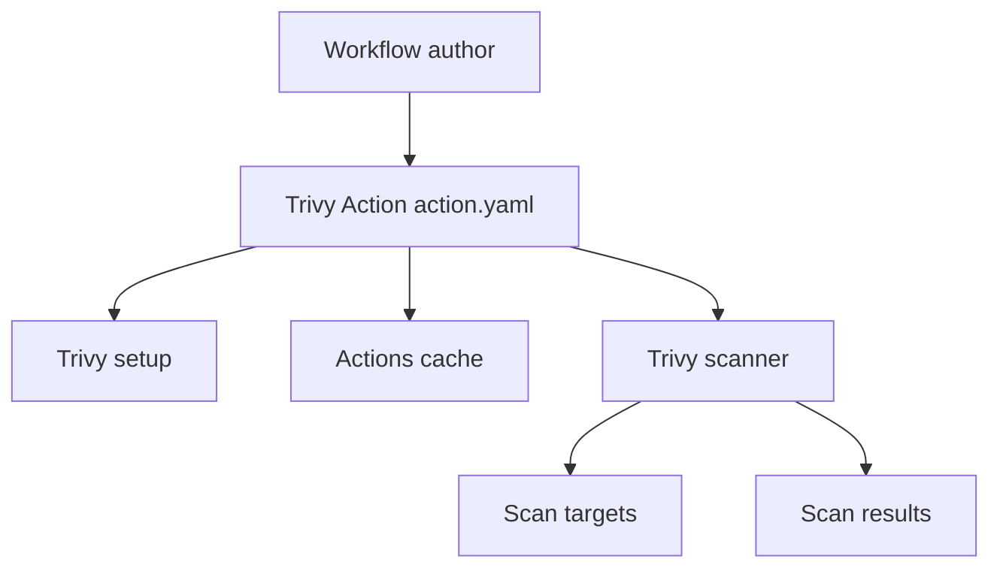

# aquasecurity/trivy-action

> Action GitHub qui lance le scanner Trivy sur images, dépôts, IaC et SBOM dans un pipeline CI.

## Le problème
Brancher un scanner de vulnérabilités dans la CI demande d'installer Trivy, de gérer son cache de bases et de publier les résultats.

## Ce que ça fait vraiment
L'action installe Trivy via `aquasecurity/setup-trivy`, restaure et sauvegarde le cache des bases de vulnérabilités, puis lance le scan : image, système de fichiers, dépôt, rootfs, configuration IaC, archive tar. Elle sort au format table, JSON, SARIF (onglet Sécurité de GitHub), template ou SBOM vers le Dependency Graph. Les options passent par `with`, des variables d'environnement ou un fichier `trivy.yaml`.

## Comment c'est branché
D'après le diagramme fourni.



## Essayer
```yaml
- name: Run Trivy vulnerability scanner
  uses: aquasecurity/trivy-action@v0.36.0
  with:
    image-ref: 'docker.io/my-organization/my-app:${{ github.sha }}'
    format: 'table'
    exit-code: '1'
    ignore-unfixed: true
    vuln-type: 'os,library'
    severity: 'CRITICAL,HIGH'
```

## Coût et pièges
Gratuit. Garde le cache activé pour éviter la limitation de débit. Les registres privés demandent des identifiants en variables d'environnement. Le téléversement SARIF exige la permission `security-events: write`.

## Ce que ce n'est pas
Pas le scanner lui-même : c'est son enveloppe GitHub Actions. Le README ne décrit pas le contenu de `entrypoint.sh`, donc rien n'est établi sur son fonctionnement interne.

## Alternatives
Aucune alternative nommée dans le README.

## Pour toi
À adopter : une étape simple pour scanner les images Docker de tes pipelines MLOps, avec des résultats lisibles dans l'onglet Sécurité.

