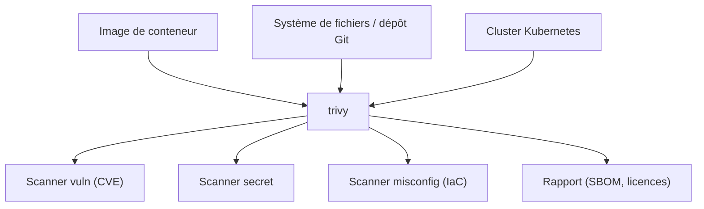

# aquasecurity/trivy

> All-purpose security scanner: vulnerabilities, secrets, misconfigurations, licenses.

## The problem
An image or repository accumulates vulnerable dependencies, forgotten secrets and permissive
infrastructure configurations, which nothing inventories in a single gesture.

## What it actually does
Crosses *targets* with *scanners*. Targets: container image, filesystem, remote Git repository,
virtual machine image, Kubernetes.
Scanners: system packages and software dependencies in use (SBOM), known vulnerabilities
(CVE), infrastructure-as-code issues and misconfigurations, sensitive information and
secrets, software licenses.
Covers most common languages, systems and platforms, and integrates with GitHub Actions,
a Kubernetes operator and a VS Code extension.

## How it is wired


## Trying it
```bash
brew install trivy
docker run aquasec/trivy
trivy image python:3.4-alpine
trivy fs --scanners vuln,secret,misconfig myproject/
trivy k8s --report summary cluster
```

## Cost and gotchas
Free. The "canary" builds, produced on every push to `main`, are explicitly discouraged
in production. The README points to Aqua, the vendor's commercial product, with a comparison
table — so the scope of the free tier may shift.

## What it is not
It is not a remediation tool: it reports, it does not fix. It is not a runtime scanner:
it analyzes artifacts and configurations, not behavior in production.
The exact list of covered languages is not in the README, it points to a dedicated page.

## Alternatives
- **Aqua**: the same vendor's commercial product, built on Trivy, for a broader scope.

## For you
To wire into the CI of your model images: one command, four families of problems.
