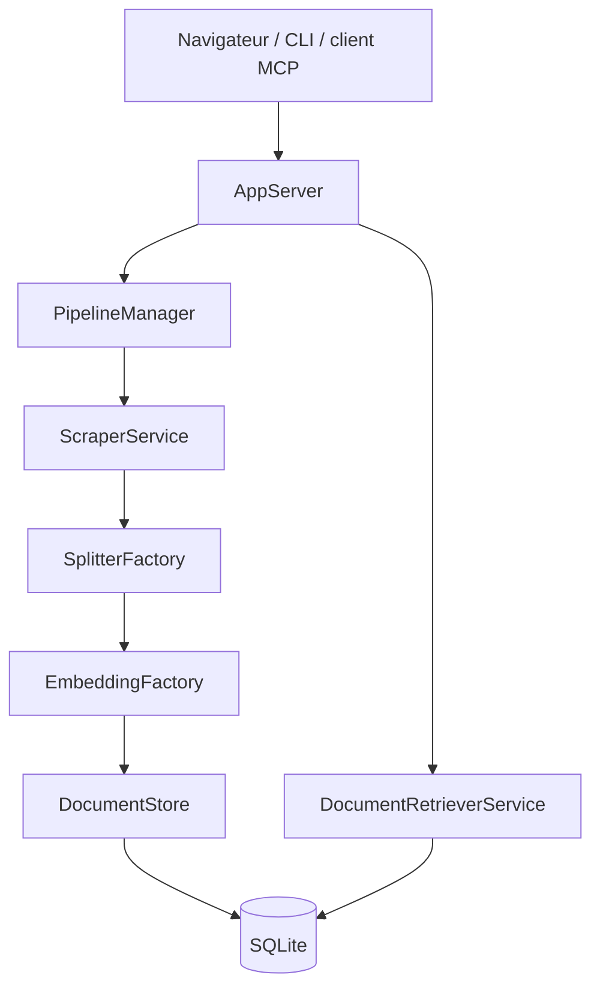

# arabold/docs-mcp-server

> Grounded Docs: indexes the documentation of the libraries you use and serves it to your coding assistant via MCP.

## The problem
A coding assistant answers from memory and gets the version of the library you use wrong.

## What it actually does
- Indexes websites, GitHub repos, npm and PyPI packages, local folders and ZIP/TAR archives.
- Reads HTML, Markdown, PDF, Office, EPUB, Jupyter notebooks and source code.
- Stores each library version separately so that search targets yours.
- Full-text search, and optional vector search (OpenAI, Ollama, Gemini, Bedrock, Azure or an OpenAI-compatible server).
- Runs locally on SQLite; MCP client over stdio or HTTP, CLI and web interface.

## How it is wired


## Trying it
```bash
npx @arabold/docs-mcp-server@latest
```
Then add libraries in the web interface (port 6280) and declare `http://localhost:6280/mcp` in your MCP client.

## Cost and gotchas
Node 22 or later. Embeddings are computed at indexing time: enable the model before adding documentation, otherwise rerun `scrape --replace`. The text is sent to the chosen embeddings provider (local with Ollama). Telemetry is on by default and can be disabled. 74 open issues.

## What it is not
Not a hosted service: you self-host it. Not a general web search engine.

## Alternatives
Context7, Nia and Ref.Tools, of which it is the open-source alternative.

## For you
Adopt: gives a coding agent versioned, local documentation, useful for your work as an AI engineer.
