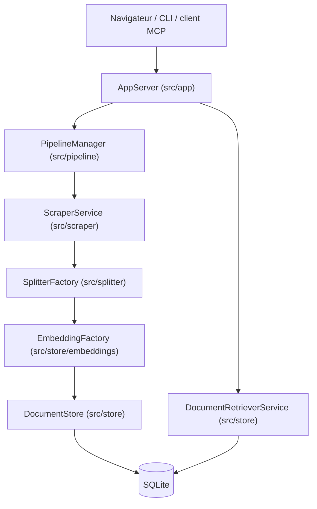

**Ce que c'est.** Grounded Docs MCP Server (MIT, 1 864 étoiles, créé en mars 2025, dernier push le 1er novembre 2026, non archivé, 74 issues ouvertes) construit un index de documentation aligné sur les versions de bibliothèques que vous utilisez, puis le sert à un assistant de code via MCP, une CLI et une interface web. L'assistant répond ainsi à partir de la documentation et non de sa mémoire. C'est une alternative open source à Context7, Nia et Ref.Tools.

**Ce qu'il fait.**
- Indexe des sites web, des dépôts GitHub, des paquets npm et PyPI, des dossiers locaux et des archives ZIP/TAR.
- Lit HTML, Markdown, PDF, Office, OpenDocument, EPUB, notebooks Jupyter et code source.
- Stocke chaque version de bibliothèque séparément, pour que la recherche cible la version du projet.
- Combine recherche plein texte et recherche vectorielle optionnelle (OpenAI, Ollama, Gemini, Vertex AI, AWS Bedrock, Azure OpenAI, ou serveur compatible OpenAI).
- Tourne en local avec une base SQLite. Le texte ne part que vers le fournisseur d'embeddings configuré, et reste local avec Ollama. La télémétrie est activée par défaut, désactivable.
- Fonctionne avec tout client MCP, en stdio ou en Streamable HTTP.

**Démarrage.** `npx @arabold/docs-mcp-server@latest` (Node 22+) ou Docker, puis ajout de bibliothèques dans l'interface web (port 6280) et déclaration de `http://localhost:6280/mcp` dans le client. Point d'attention : les embeddings se calculent à l'indexation, donc il faut activer le modèle avant d'ajouter la documentation, sinon il faut relancer `scrape --replace`.

**Architecture d'après le code.** Application Node.js/TypeScript modulaire, utilisable en processus unique ou éclatée en services via Docker Compose. Le flux central est : scraper, middleware, splitter, embeddings, store, puis recherche par `DocumentRetrieverService`. Les écritures (indexation asynchrone par jobs) sont séparées des lectures (recherche).

**Verdict.** Outil mûr et actif, licence permissive, utile à un profil data/AI engineer pour fournir à un agent de code une documentation versionnée et locale. Recoupe directement Context7 mais se déploie en auto-hébergé. Réserve : 74 issues ouvertes et télémétrie par défaut.

