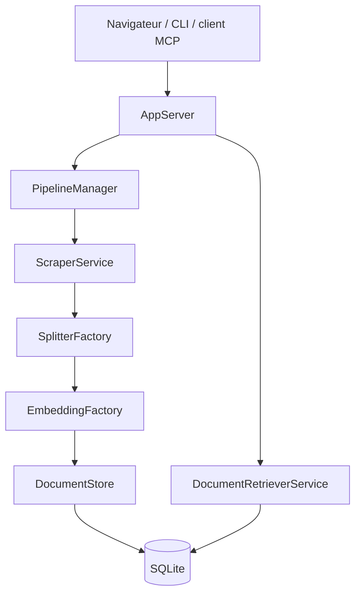

# arabold/docs-mcp-server

> Grounded Docs : indexe la documentation des bibliothèques que tu utilises et la sert à ton assistant de code via MCP.

## Le problème
Un assistant de code répond de mémoire et se trompe sur la version de la bibliothèque que tu utilises.

## Ce que ça fait vraiment
- Indexe des sites web, dépôts GitHub, paquets npm et PyPI, dossiers locaux et archives ZIP/TAR.
- Lit HTML, Markdown, PDF, Office, EPUB, notebooks Jupyter et code source.
- Stocke chaque version de bibliothèque séparément pour que la recherche cible la tienne.
- Recherche plein texte, et vectorielle en option (OpenAI, Ollama, Gemini, Bedrock, Azure ou serveur compatible OpenAI).
- Tourne en local sur SQLite ; client MCP en stdio ou HTTP, CLI et interface web.

## Comment c'est branché


## Essayer
```bash
npx @arabold/docs-mcp-server@latest
```
Puis ajoute des bibliothèques dans l'interface web (port 6280) et déclare `http://localhost:6280/mcp` dans ton client MCP.

## Coût et pièges
Node 22 ou plus. Les embeddings se calculent à l'indexation : active le modèle avant d'ajouter la documentation, sinon relance `scrape --replace`. Le texte part vers le fournisseur d'embeddings choisi (local avec Ollama). Télémétrie activée par défaut, désactivable. 74 issues ouvertes.

## Ce que ce n'est pas
Pas un service hébergé : tu l'auto-héberges. Pas un moteur de recherche web général.

## Alternatives
Context7, Nia et Ref.Tools, dont c'est l'alternative open source.

## Pour toi
À adopter : donne à un agent de code une documentation versionnée et locale, utile à ton travail d'AI engineer.
