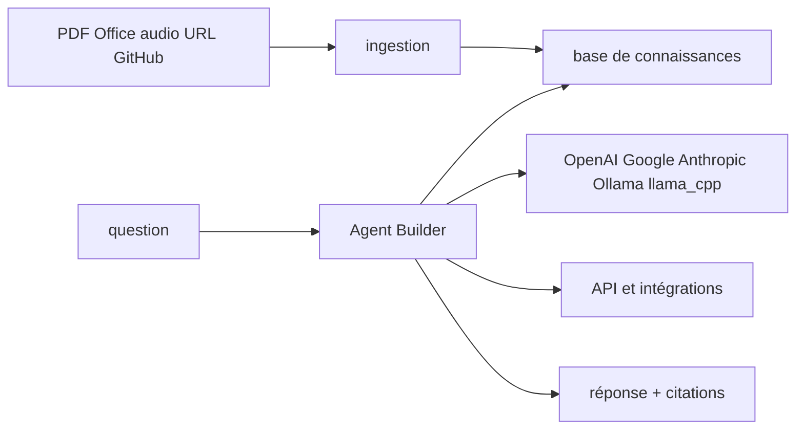

# arc53/DocsGPT

> Private agent and document search platform, deployable at your place with the model of your choice.

## The problem
Asking questions of your internal documentation requires an ingestion pipeline, an index, and sourced answers.
Assembling all this yourself takes weeks, and uncited answers are not usable.

## What it actually does
Ingests PDF, DOCX, CSV, XLSX, EPUB, MD, HTML, JSON, PPTX, images, and audio MP3, WAV, M4A, OGG, WebM.
Transcribes audio server-side: voice notes and meeting recordings become searchable corpus.
Also pulls in URLs, sitemaps, Reddit and GitHub via web crawlers.
Returns answers with source citations, and exposes API keys tied to your documents and models.

## How it is wired


## Trying it
```bash
curl -fsSL https://docs.ac/install | bash
```
From a clone: `git clone https://github.com/arc53/DocsGPT.git`, `cd DocsGPT`, then `./setup.sh`.
The installer offers five options (public API, local, local engine, cloud provider, local image).

## Cost and gotchas
Docker is mandatory; the installer checks for it first. Depending on the option chosen, the token bill
is on you; local mode (Ollama, llama_cpp) avoids it at the price of hardware.

## What it is not
Not a turnkey enterprise search engine: it is a platform you have to feed and operate.
Not guaranteed error-free: "hallucination-free" is their phrase, the citations are what you can verify.
Not a simple widget: the repo ships a Flask backend, React frontend, widgets and integrations.

## Alternatives
None named in the README.

## For you
A ready-assembled RAG foundation, to try in local mode before pouring a client's documentation into it.
