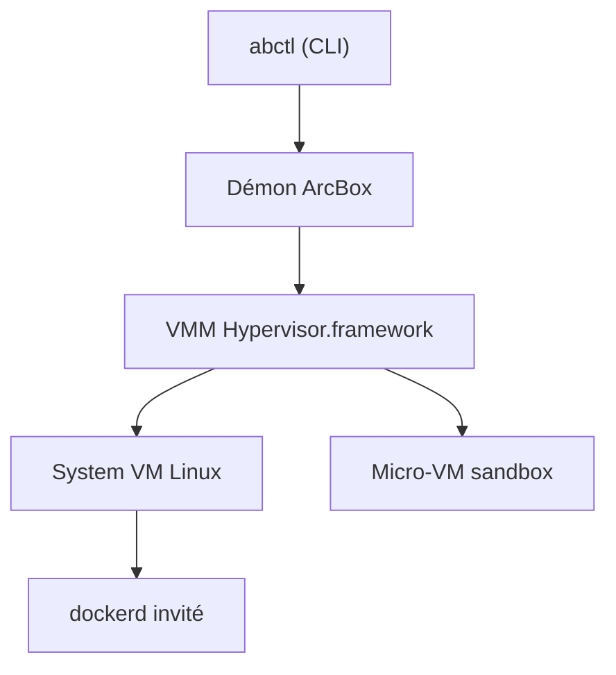

# arcboxlabs/arcbox

> Container and virtual machine engine for Mac, written in Rust, an open alternative to Docker Desktop.

## The problem
Docker Desktop is heavy on macOS and OrbStack, which is faster, is closed source.

## What it actually does
A daemon and a CLI (abctl) drive four kinds of workload: Docker-compatible containers with k3s, disposable micro-VMs for AI agents, full Linux machines and macOS guests. The VMM, the VirtIO devices and the user-space networking are written in-house. amd64 images go through the FEX emulator on Apple Silicon. The project is in public beta and announces measured throughput gains on its network benchmark.

## How it is wired
Simplified diagram based on the fiche, no diagram provided.


## Trying it
```bash
brew install --cask arcboxlabs/tap/arcbox
abctl daemon start
abctl docker enable
docker run -d -p 8080:80 nginx
```

## Cost and gotchas
Free. macOS on Apple Silicon only; sandboxes require an M3 or later and macOS 15. At most two macOS guests per Mac. The HTTPS certificate trust helper requires administrator rights.

## What it is not
It is not a Linux or Windows tool. The performance goals in the table are targets, not measurements. The README mentions MIT and Apache-2.0 whereas the catalog says Apache-2.0.

## Alternatives
Docker Desktop and OrbStack: the latter is more mature but closed source.

## For you
Worth watching: interesting for isolating AI agents in micro-VMs on Mac, but beta and limited to Apple hardware.
