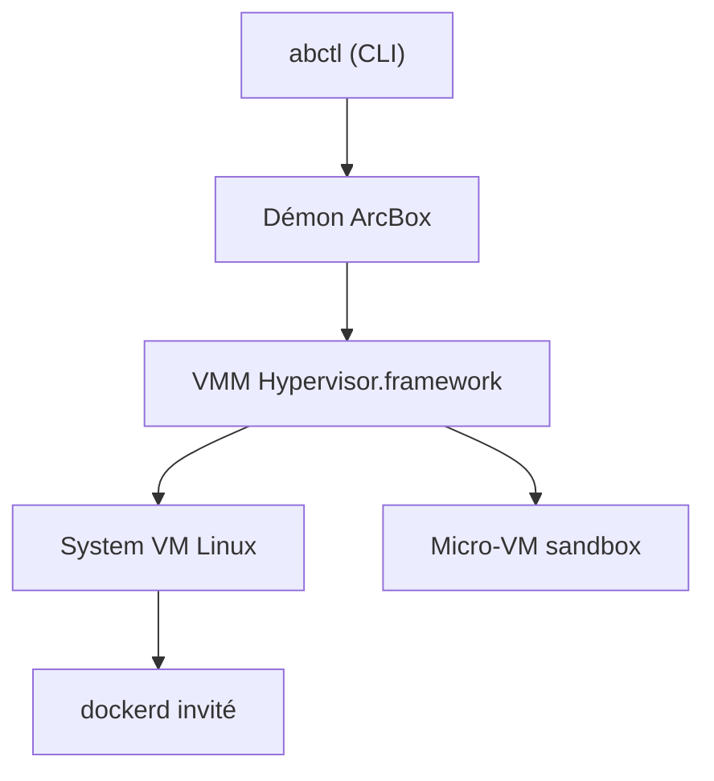

# arcboxlabs/arcbox

> Moteur de conteneurs et de machines virtuelles pour Mac, en Rust, alternative libre à Docker Desktop.

## Le problème
Docker Desktop est lourd sur macOS et OrbStack, plus rapide, est fermé.

## Ce que ça fait vraiment
Un démon et une CLI (abctl) pilotent quatre types de charge : conteneurs compatibles Docker avec k3s, micro-VM jetables pour agents IA, machines Linux complètes et invités macOS. Le VMM, les périphériques VirtIO et le réseau en espace utilisateur sont écrits en interne. Les images amd64 passent par l'émulateur FEX sur Apple Silicon. Le projet est en bêta publique et annonce des gains de débit mesurés sur son banc réseau.

## Comment c'est branché
Schéma simplifié d'après la fiche, sans diagramme fourni.


## Essayer
```bash
brew install --cask arcboxlabs/tap/arcbox
abctl daemon start
abctl docker enable
docker run -d -p 8080:80 nginx
```

## Coût et pièges
Gratuit. macOS sur Apple Silicon uniquement ; les sandboxes demandent un M3 ou plus et macOS 15. Deux invités macOS au maximum par Mac. L'aide à la confiance du certificat HTTPS demande des droits administrateur.

## Ce que ce n'est pas
Ce n'est pas un outil Linux ni Windows. Les objectifs de performance du tableau sont des cibles, pas des mesures. Le README parle de MIT et Apache-2.0 alors que le catalogue indique Apache-2.0.

## Alternatives
Docker Desktop et OrbStack : le second est plus mûr mais fermé.

## Pour toi
Surveiller : intéressant pour isoler des agents IA en micro-VM sur Mac, mais bêta et limité au matériel Apple.

