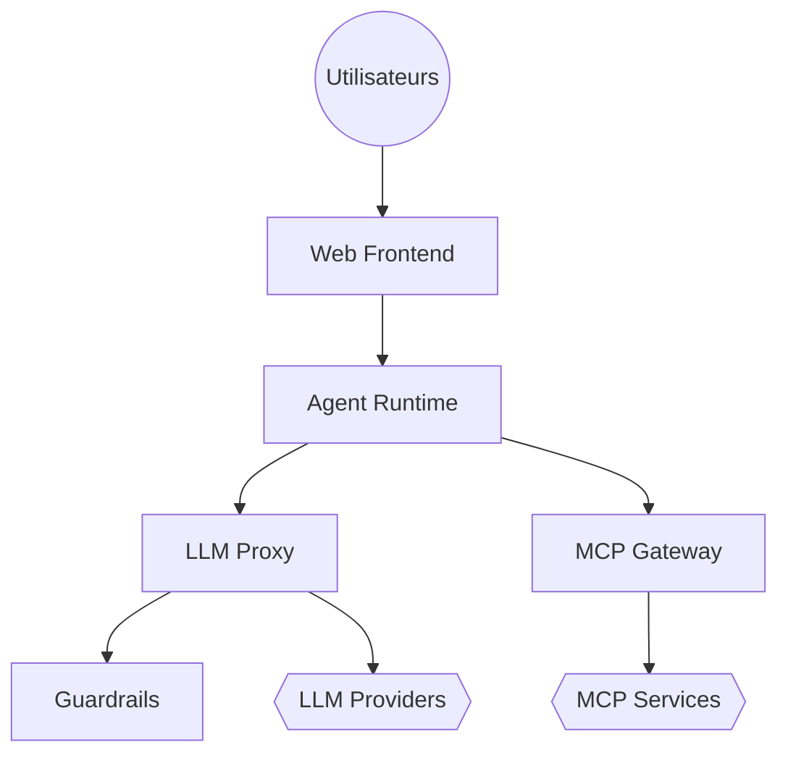

# archestra-ai/archestra

> Enterprise platform that brings LLM, MCP and A2A gateways, agents and guardrails together behind one URL.

## The problem
Teams deploy agents and MCP tools with no shared identity, no cost limits and no control over tool calls.

## What it actually does
Provides a chat interface, an LLM gateway (costs, virtual keys), an MCP gateway with OAuth, an A2A gateway, a private MCP registry, an agent runtime, a knowledge base, a mini-app builder, deterministic guardrails, SSO/RBAC and observability (OpenTelemetry, Prometheus).

## How it is wired


## Trying it
```bash
docker pull archestra/platform:latest

docker run \
  -p 127.0.0.1:9000:9000 -p 127.0.0.1:3000:3000 \
  -e ARCHESTRA_QUICKSTART=true \
  -v /var/run/docker.sock:/var/run/docker.sock \
  -v archestra-postgres-data:/var/lib/postgresql/data \
  -v archestra-app-data:/app/data \
  archestra/platform:latest
```

## Cost and gotchas
Open core model: free under 30 users, enterprise license beyond that. Startup mounts the Docker socket. The `latest` tag often tracks a release candidate: pin a version in production.

## What it is not
Not a simple proxy: it is a complete platform to deploy. The README's performance figures and references are vendor claims, not verified here.

## Alternatives
No alternative named in the README.

## For you
Watch: interesting for governing agents and MCP in a team, but the license needs checking and the open core model limits free use.
