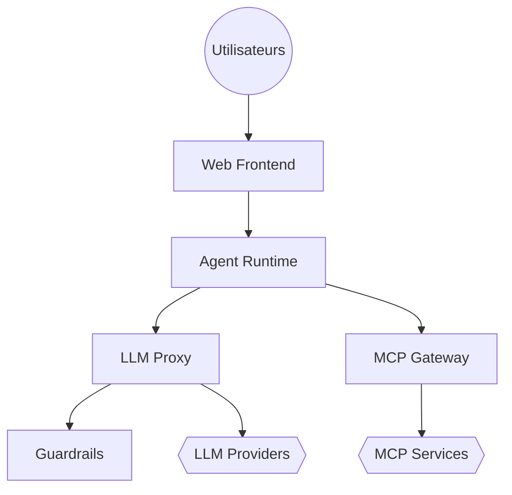

# archestra-ai/archestra

> Plateforme d'entreprise qui regroupe passerelles LLM, MCP et A2A, agents et garde-fous derrière une URL.

## Le problème
Les équipes déploient des agents et des outils MCP sans identité commune, sans limites de coût ni contrôle des appels d'outils.

## Ce que ça fait vraiment
Fournit une interface de chat, une passerelle LLM (coûts, clés virtuelles), une passerelle MCP avec OAuth, une passerelle A2A, un registre MCP privé, un runtime d'agents, une base de connaissances, un constructeur de mini-apps, des garde-fous déterministes, SSO/RBAC et de l'observabilité (OpenTelemetry, Prometheus).

## Comment c'est branché


## Essayer
```bash
docker pull archestra/platform:latest

docker run \
  -p 127.0.0.1:9000:9000 -p 127.0.0.1:3000:3000 \
  -e ARCHESTRA_QUICKSTART=true \
  -v /var/run/docker.sock:/var/run/docker.sock \
  -v archestra-postgres-data:/var/lib/postgresql/data \
  -v archestra-app-data:/app/data \
  archestra/platform:latest
```

## Coût et pièges
Modèle open core : gratuit sous 30 utilisateurs, licence entreprise au-delà. Le démarrage monte le socket Docker. Le tag `latest` suit souvent une version candidate : épingler une version en production.

## Ce que ce n'est pas
Ce n'est pas un simple proxy : c'est une plateforme complète à déployer. Les performances et références du README sont des déclarations de l'éditeur, non vérifiées ici.

## Alternatives
Aucune alternative nommée dans le README.

## Pour toi
Surveiller : intéressant pour gouverner agents et MCP en équipe, mais la licence est à vérifier et le modèle open core limite l'usage gratuit.

