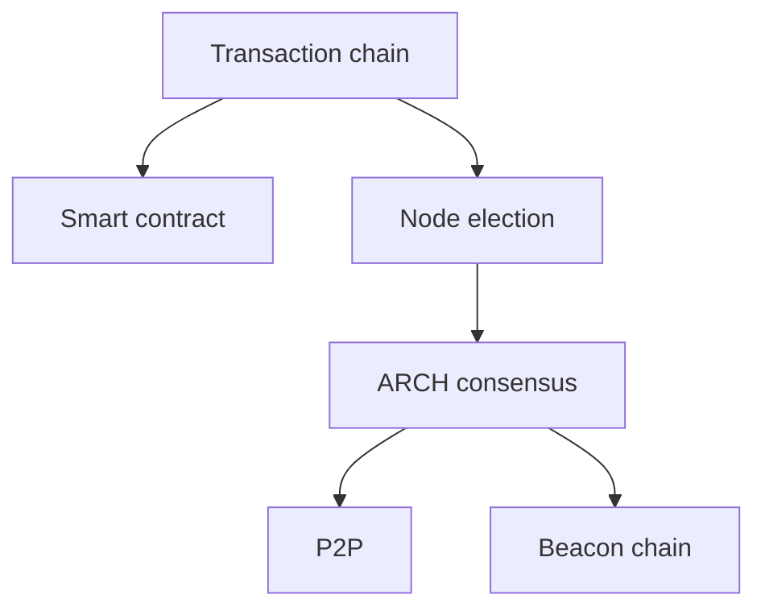

# archethic-foundation/archethic-node

> Node of the Archethic blockchain, which advertises transaction chains and smart contracts.

## The problem
The project aims for a blockchain that is more extensible and less energy-hungry than existing ones.

## What it actually does
An Elixir node with transaction chains, a contract interpreter, node election, P2P, ARCH consensus, a beacon chain, an embedded explorer, internal oracles and a dedicated database. Testnet and mainnet deployment are announced according to the roadmap.

## How it is wired
Simplified diagram based on the sheet, no diagram provided.



## Trying it
```bash
git clone https://github.com/archethic-foundation/archethic-node.git
cd archethic-node
mix deps.get
iex -S mix
docker compose up node1
```

## Cost and gotchas
Elixir 1.14, Erlang OTP 25, Libsodium, GMP, MiniUPnP and Npm. The advertised throughput (more than a million transactions per second) is not demonstrated in the README.

## What it is not
Not a usable public network: testnet and mainnet have yet to open.

## Alternatives
- No alternative named in the README.

## For you
Ignore: a blockchain project, unrelated to data / AI / MLOps.
