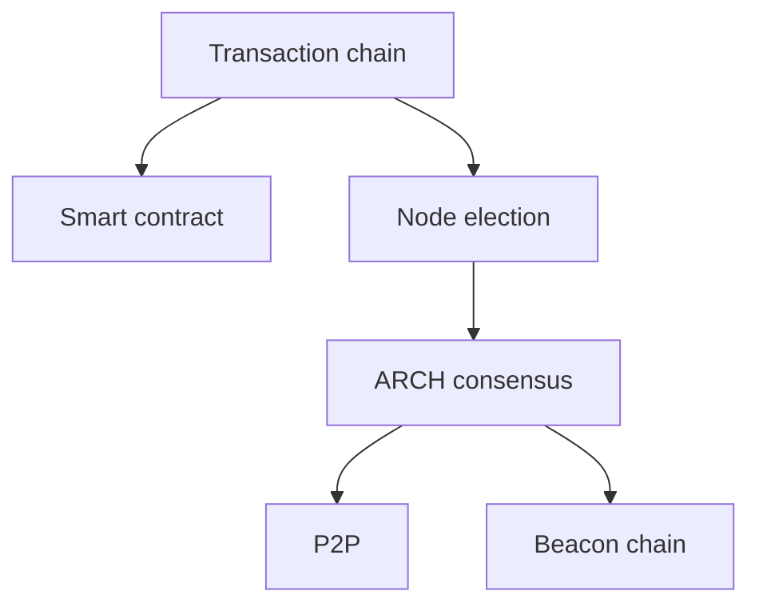

# archethic-foundation/archethic-node

> Nœud de la blockchain Archethic, qui annonce chaînes de transactions et contrats intelligents.

## Le problème
Le projet vise une blockchain plus extensible et moins gourmande en énergie que celles existantes.

## Ce que ça fait vraiment
Nœud Elixir avec chaînes de transactions, interpréteur de contrats, élection de nœuds, P2P, consensus ARCH, chaîne beacon, explorateur embarqué, oracles internes et base de données dédiée. Le déploiement testnet et mainnet est annoncé selon la feuille de route.

## Comment c'est branché
Schéma simplifié d'après la fiche, sans diagramme fourni.



## Essayer
```bash
git clone https://github.com/archethic-foundation/archethic-node.git
cd archethic-node
mix deps.get
iex -S mix
docker compose up node1
```

## Coût et pièges
Elixir 1.14, Erlang OTP 25, Libsodium, GMP, MiniUPnP et Npm. Les débits annoncés (plus d'un million de transactions par seconde) ne sont pas démontrés dans le README.

## Ce que ce n'est pas
Pas un réseau public utilisable : testnet et mainnet restent à ouvrir.

## Alternatives
- Aucune alternative nommée dans le README.

## Pour toi
Ignorer : un projet blockchain, sans lien avec data / IA / MLOps.

