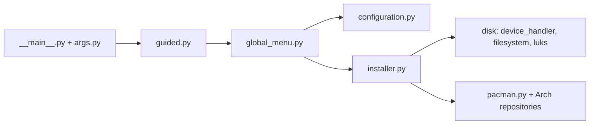

# archlinux/archinstall

> Guided or automated Arch Linux installer, which also serves as a Python system-management library.

## The problem
Installing Arch by hand is slow; you want a guided or scriptable, reproducible path.

## What it actually does
Interactive menu (disk, LUKS/LVM encryption, network, mirrors, users, Desktop or Server profiles, bootloader), or execution from a JSON configuration file and a separate, encryptable credentials file. User passwords are hashed with yescrypt; the disk encryption password must stay in clear text to be applied. The library lets you write your own installation scripts. It modifies real disks.

## How it is wired


## Trying it
```bash
pacman-key --init
pacman -Sy archinstall
archinstall
archinstall --config <path or URL> --creds <path or URL>
archinstall --script <name>
```

## Cost and gotchas
Free. It destroys or repartitions disks: test in a VM or on an image (the README details QEMU). The live ISO's ramdisk space may run short for an update. No AUR or AUR helpers, by design.

## What it is not
It is not a fleet deployment or post-installation configuration management tool.

## Alternatives
No alternative named in the README.

## For you
Ignore: installer for an Arch workstation, unrelated to data/AI/MLOps work, unless you automate Arch workstation installations.
