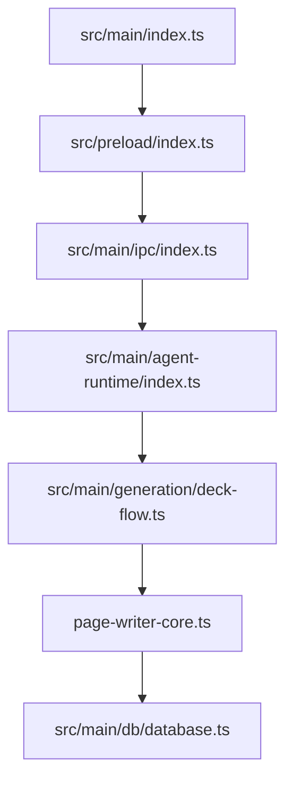

# arcsin1/oh-my-ppt

> Desktop application that generates, edits and exports HTML presentations with an AI model.

## The problem
AI presentation tools produce frozen files that are hard to adjust or animate.

## What it actually does
Electron application: from a theme or documents (txt, md, csv, docx), an agent plans the outline and then writes pages in HTML, with image generation, more than 90 styles and animations. It imports a PPTX and exports to editable PPTX, PDF, PNG or MP4. Sessions and files stay local, with Git history.

## How it is wired

## Trying it
No documented command: install the package from the Releases. For a local Ollama, set `provider: openai`, `base_url: http://127.0.0.1:11434/v1` and a non-empty key. Unsigned macOS app: `xattr -cr /Applications/OhMyPPT.app`.

## Cost and gotchas
Free, but a text model (and an image model for visuals) must be configured with your key; requests go to the provider you choose. Unsigned packages. README full of API gateway sponsor banners.

## What it is not
Not a model and not a hosted service. The "close to 100%" fidelity when restoring a PPTX is the author's claim, limited on complex charts.

## Alternatives
No alternative named in the README.

## For you
Ignore: an office-productivity tool, useful as an example of a generation agent but unrelated to the data / MLOps core.
