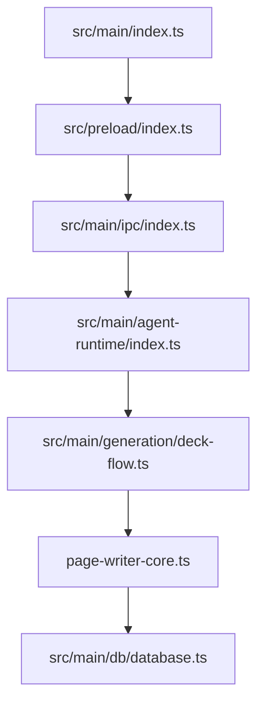

# arcsin1/oh-my-ppt

> Application de bureau qui génère, édite et exporte des présentations HTML avec un modèle d'IA.

## Le problème
Les outils de présentation IA produisent des fichiers figés, difficiles à ajuster ou à animer.

## Ce que ça fait vraiment
Application Electron : à partir d'un thème ou de documents (txt, md, csv, docx), un agent planifie le plan puis écrit des pages en HTML, avec génération d'images, plus de 90 styles et des animations. Elle importe un PPTX et exporte en PPTX éditable, PDF, PNG ou MP4. Les sessions et fichiers restent en local, avec historique Git.

## Comment c'est branché

## Essayer
Aucune commande documentée : installer le paquet depuis les Releases. Pour Ollama local, régler `provider: openai`, `base_url: http://127.0.0.1:11434/v1` et une clé non vide. macOS non signé : `xattr -cr /Applications/OhMyPPT.app`.

## Coût et pièges
Gratuit, mais un modèle texte (et un modèle d'image pour les visuels) doit être configuré avec ta clé ; les requêtes partent vers le fournisseur choisi. Paquets non signés. README rempli de bannières de sponsors de passerelles d'API.

## Ce que ce n'est pas
Ce n'est pas un modèle ni un service hébergé. La restitution « proche de 100 % » d'un PPTX est une affirmation de l'auteur, limitée sur graphiques complexes.

## Alternatives
Aucune alternative nommée dans le README.

## Pour toi
À ignorer : outil de bureautique, utile comme exemple d'agent de génération mais sans rapport avec le cœur data / MLOps.

