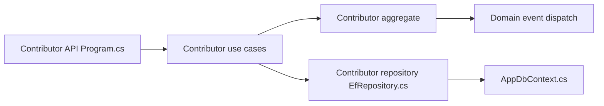

# ardalis/CleanArchitecture

> ASP.NET Core starter template applying Clean Architecture, for .NET developers.

## The problem
Structuring a .NET solution into loosely coupled layers (domain, application, infrastructure) without starting from scratch.

## What it actually does
Solution template (main branch on .NET 9, NuGet package 10.x). The code contains two examples: contributor management (API, use cases, aggregate, EF repository, domain events, e-mail sending) and a mini cart/catalog. The README is mostly a pointer to the documentation and NimblePros training.

## How it is wired

## Trying it
The README contains no command: it points to the online documentation.

## Cost and gotchas
Free (MIT). Paid courses and coaching are promoted in the README. Version migrations must be read.

## What it is not
Not a library to reference: a starting template to copy. Nothing about data or AI.

## Alternatives
No alternative named in the README (hexagonal, onion, ports-and-adapters are cited as synonyms).

## For you
Outside the data/AI scope; ignore unless you write APIs in C#.
