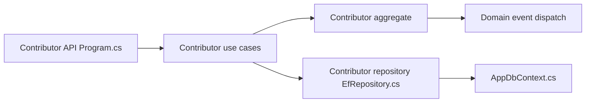

# ardalis/CleanArchitecture

> Gabarit de départ ASP.NET Core appliquant la Clean Architecture, pour développeurs .NET.

## Le problème
Structurer une solution .NET en couches faiblement couplées (domaine, application, infrastructure) sans repartir de zéro.

## Ce que ça fait vraiment
Template de solution (branche principale en .NET 9, paquet NuGet 10.x). Le code contient deux exemples : gestion de contributeurs (API, use cases, agrégat, dépôt EF, événements de domaine, envoi d'e-mail) et mini panier/catalogue. Le README est surtout un renvoi vers la documentation et des formations NimblePros.

## Comment c'est branché

## Essayer
Le README ne contient aucune commande : il renvoie à la documentation en ligne.

## Coût et pièges
Gratuit (MIT). Cours et accompagnement payants promus dans le README. Migrations de version à lire.

## Ce que ce n'est pas
Pas une bibliothèque à référencer : un modèle de départ à copier. Rien sur les données ni l'IA.

## Alternatives
Aucune alternative nommée dans le README (hexagonal, onion, ports-and-adapters sont cités comme synonymes).

## Pour toi
Hors périmètre data/IA ; à ignorer sauf si tu écris des API en C#.

