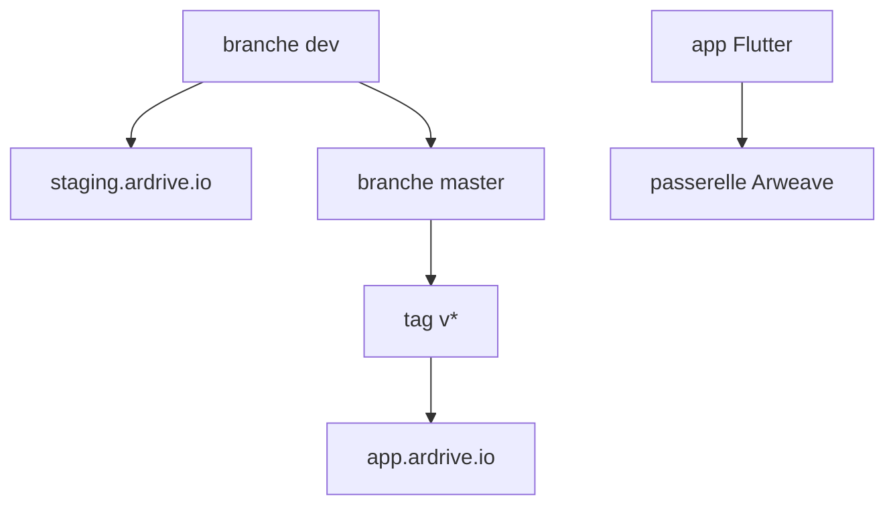

# ardriveapp/ardrive-web

> Flutter application to log in to ArDrive, and view, upload and manage your files stored on Arweave.

## The problem
Storing files permanently on Arweave requires an interface. This web and mobile application is one.

## What it actually does
It lets you log in, upload and manage ArDrive files. Three build profiles exist: development, staging, production. A custom Arweave gateway is set through the browser's Local Storage. Changes on `dev` flow continuously to staging.ardrive.io.

## How it is wired
Simplified diagram based on the sheet, no diagram provided.


## Trying it
```bash
lefthook install
flutter pub get
flutter pub run build_runner build --delete-conflicting-outputs
flutter run -d chrome --dart-define=environment=development
```

## Cost and gotchas
The Flutter SDK and lefthook must be installed; code generation is mandatory on every branch change. Arweave storage has its own cost, not detailed in the README.

## What it is not
Neither a library nor a standalone service: it is the web client of a storage service. No data or AI tool.

## Alternatives
No alternative named in the README.

## For you
Ignore: an Arweave storage client application, unrelated to data, AI or MLOps work.
