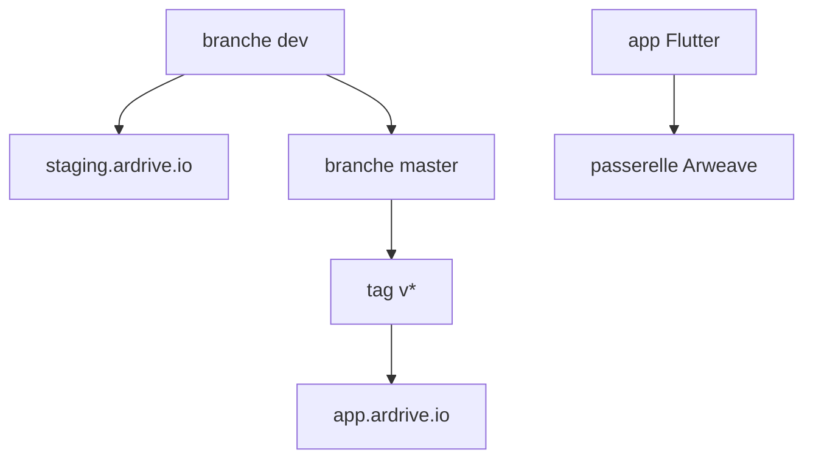

# ardriveapp/ardrive-web

> Application Flutter pour se connecter à ArDrive, voir, envoyer et gérer ses fichiers stockés sur Arweave.

## Le problème
Stocker des fichiers de façon permanente sur Arweave demande une interface. Cette application web et mobile en est une.

## Ce que ça fait vraiment
Elle permet de se connecter, d'envoyer et de gérer des fichiers ArDrive. Trois profils de build existent : development, staging, production. Une passerelle Arweave personnalisée se règle via le Local Storage du navigateur. Les changements de `dev` partent en continu vers staging.ardrive.io.

## Comment c'est branché
Schéma simplifié d'après la fiche, sans diagramme fourni.


## Essayer
```bash
lefthook install
flutter pub get
flutter pub run build_runner build --delete-conflicting-outputs
flutter run -d chrome --dart-define=environment=development
```

## Coût et pièges
Le SDK Flutter et lefthook sont à installer ; la génération de code est obligatoire à chaque changement de branche. Le stockage Arweave a son propre coût, non détaillé dans le README.

## Ce que ce n'est pas
Ni une bibliothèque ni un service autonome : c'est le client web d'un service de stockage. Aucun outil de data ou d'IA.

## Alternatives
Aucune alternative nommée dans le README.

## Pour toi
À ignorer : application cliente de stockage Arweave, sans lien avec un travail data, IA ou MLOps.

