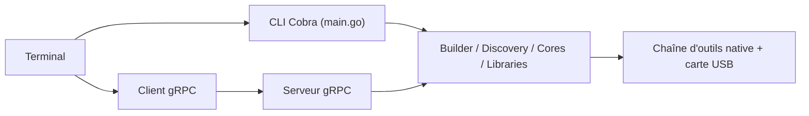

# arduino/arduino-cli

> Command-line tool and gRPC daemon to manage, compile and upload to Arduino boards.

## The problem
Compiling and uploading Arduino programs without going through the graphical editor, notably in automation.

## What it actually does
The README is short and points to the documentation. Based on the architecture: CLI (Cobra) and gRPC daemon mode; board and library managers, sketch building, board detection, upload, serial monitor, debugging, verified package downloads.

## How it is wired


## Trying it
```bash
# Aucune commande documentée dans ce README : installation, prise en main
# et référence des commandes sont dans la documentation liée.
```

## Cost and gotchas
Free. Native compilers and board tools are downloaded from HTTP registries. GPL-3.0 license. Nightly versions available for testing.

## What it is not
Not a development environment: no editor. The README presents no concrete command.

## Alternatives
No alternative named in the README.

## For you
Worth watching: useful only if you compile or upload Arduino firmware via CLI or CI; irrelevant without hardware.
