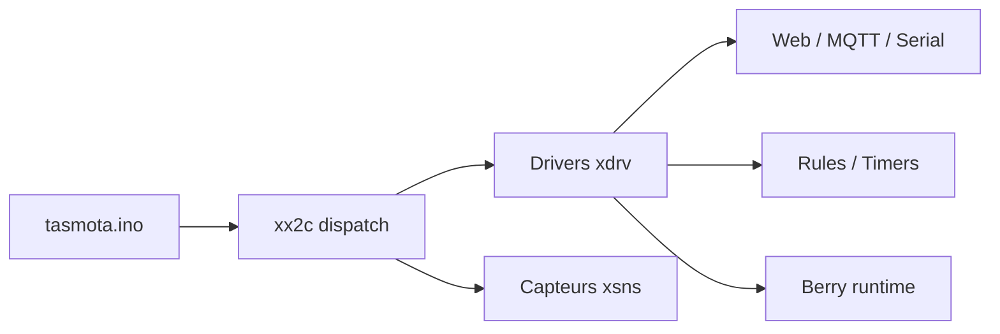

# arendst/Tasmota

> Alternative firmware for ESP8266/ESP32 chips, with local control via MQTT, HTTP or serial.

## The problem
Original connected devices depend on a proprietary cloud and are hard to configure.

## What it actually does
Replaces the firmware of an ESP device: web interface, OTA updates, timers and rules, more than 150 sensors, Matter (ESP32), Zigbee, BLE, LVGL, Berry scripts, WireGuard, Home Assistant, openHAB and Domoticz integrations. Precompiled binaries do not contain everything (flash limit): some features require a PlatformIO build.

## How it is wired

## Trying it
Install via the WebInstaller or binaries on `ota.tasmota.com`, no command in the README; build with PlatformIO and `user_config_override.h`.

## Cost and gotchas
Free, but hardware to buy. Risk of electrocution on mains power: the README insists on it. A failed update may force a reflash over the serial port.

## What it is not
Not PC software. Migrations from old versions go through mandatory steps.

## Alternatives
No alternative named in the README.

## For you
Outside the data/AI scope except for home automation; ignore for your professional watch.
