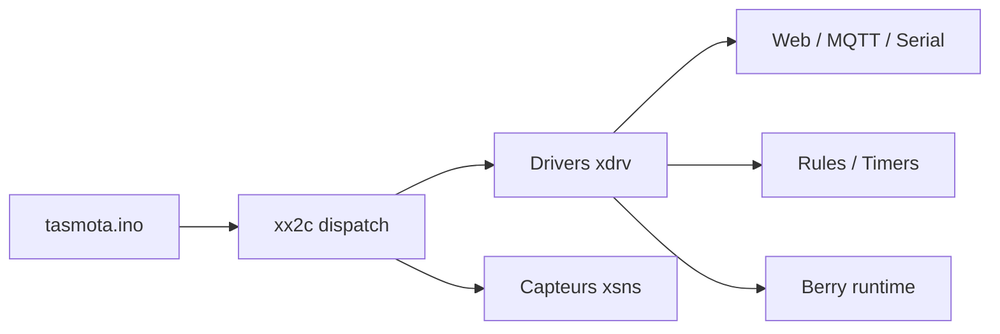

# arendst/Tasmota

> Firmware alternatif pour puces ESP8266/ESP32, avec contrôle local par MQTT, HTTP ou série.

## Le problème
Les objets connectés d'origine dépendent d'un cloud propriétaire et sont peu configurables.

## Ce que ça fait vraiment
Remplace le firmware d'un appareil ESP : interface web, mises à jour OTA, timers et règles, plus de 150 capteurs, Matter (ESP32), Zigbee, BLE, LVGL, scripts Berry, WireGuard, intégrations Home Assistant, openHAB, Domoticz. Les binaires précompilés ne contiennent pas tout (limite de flash) : certaines fonctions demandent une compilation PlatformIO.

## Comment c'est branché

## Essayer
Installation via le WebInstaller ou binaires sur `ota.tasmota.com`, sans commande dans le README ; compilation avec PlatformIO et `user_config_override.h`.

## Coût et pièges
Gratuit, mais matériel à acheter. Danger d'électrocution sur secteur : le README insiste. Une mise à jour ratée peut imposer un reflash par port série.

## Ce que ce n'est pas
Pas un logiciel pour PC. Les migrations de versions anciennes passent par des étapes obligatoires.

## Alternatives
Aucune alternative nommée dans le README.

## Pour toi
Hors périmètre data/IA sauf domotique ; à ignorer pour ta veille professionnelle.

