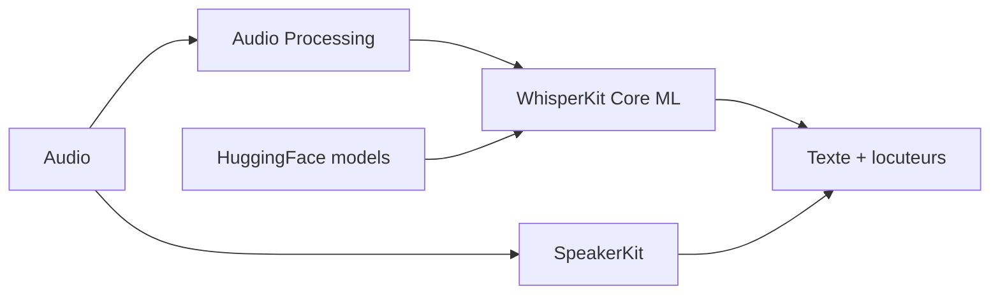

# argmaxinc/WhisperKit

> Swift SDK to transcribe, diarize and synthesize speech on Apple devices, without a server.

## The problem
Doing speech recognition on an iPhone or Mac without sending the audio to a remote service.

## What it actually does
Three Swift kits in a single package: WhisperKit (Whisper transcription in Core ML), SpeakerKit (Pyannote v4 diarization) and TTSKit (Qwen3-TTS synthesis, 9 voices, 10 languages, streaming playback). A `argmax-cli` CLI offers transcription, diarization, synthesis and a local server compatible with the OpenAI audio API (transcription and translation). Models are downloaded from Hugging Face. A paid Pro version exists with real time and Android.

## How it is wired


## Trying it
```bash
brew install whisperkit-cli
```
```bash
swift run argmax-cli transcribe --model-path "Models/whisperkit-coreml/openai_whisper-large-v3-v20240930_626MB" --audio-path "path/to/your/audio.wav"
```

## Cost and gotchas
macOS 14+ and Xcode 16+. The first launch downloads the models (1 to 2.2 GB for TTSKit). The local server only returns `json` and `verbose_json`, with the model fixed at startup.

## What it is not
Not cross-platform (Apple silicon); real-time transcription with speakers and Android belong to the Pro offering. The repository name (WhisperKit) differs from the current package `argmax-oss-swift`.

## Alternatives
Argmax Pro SDK, for real time and Android (paid offering from the same vendor).

## For you
Adopt for speech embedded in an Apple app; outside the Apple ecosystem, it brings nothing.
