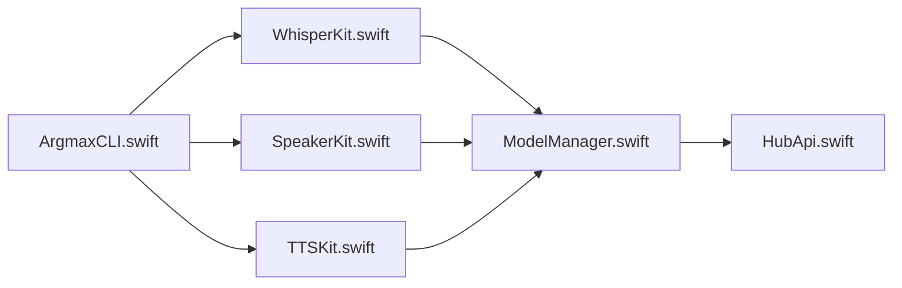

# argmaxinc/argmax-oss-swift

> Swift kits for local inference: Whisper transcription, Pyannote diarization and Qwen3-TTS speech synthesis on Apple silicon.

## The problem
Integrating speech recognition, speaker identification and speech synthesis into an Apple app without a server or cloud API.

## What it actually does
Three Swift Package products: WhisperKit (Whisper on CoreML), SpeakerKit (Pyannote v4) and TTSKit (Qwen3-TTS 0.6B or 1.7B, 9 voices, 10 languages). SpeakerKit can merge its segments with a transcript. A `argmax-cli` CLI includes a local server compatible with the OpenAI audio API (json and verbose_json only). Models are downloaded from HuggingFace on first use.

## How it is wired


## Trying it
```bash
brew install whisperkit-cli
git clone https://github.com/argmaxinc/argmax-oss-swift.git
cd argmax-oss-swift
make setup
make download-model MODEL=large-v3-v20240930_626MB
swift run argmax-cli transcribe --model-path "Models/whisperkit-coreml/openai_whisper-large-v3-v20240930_626MB" --audio-path "path/to/your/audio.wav"
```

## Cost and gotchas
Free, but models weigh from 626 MB to 2.2 GB. macOS 14+ and Xcode 16+ required (TTSKit: macOS 15 / iOS 18). The README mentions a paid Pro SDK with real-time, custom vocabulary and Android.

## What it is not
Not portable outside Apple. The open version does not offer real-time transcription with speakers, which is reserved for the Pro offer.

## Alternatives
- Argmax Pro SDK: adds real-time, custom vocabulary, Android.

## For you
Worth watching: relevant if you ship voice on Mac/iOS, off-topic for a Linux server pipeline.
