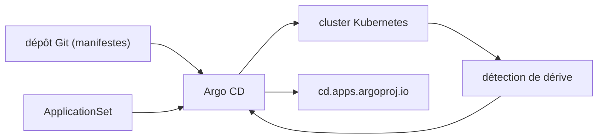

# argoproj/argo-cd

> Declarative GitOps continuous delivery for Kubernetes, for platform teams.

## The problem
Deploying to Kubernetes from an imperative pipeline makes the cluster's real state unverifiable:
you no longer know what is running, who pushed it, or how to roll back.

## What it actually does
The README is very short on the mechanics: it sets out two principles — declarative, versioned
application definitions, configurations and environments; and automated, auditable, easy-to-understand
deployment and lifecycle. The rest of the file is a list of blog posts and talks (ApplicationSet,
Argo CD Image Updater, Crossplane, KubeVela, Argo Rollouts with Istio, Kubeflow, Helm, Renovate) and a
link to a public demo at `cd.apps.argoproj.io`.

## How it is wired

## Trying it
No installation command is documented in this README: it points to the full documentation
and the online demo.

## Cost and gotchas
Free, but it assumes a Kubernetes cluster already in place and administered — that is the real cost.
The README mentions no version prerequisites, no resources, and no license.

## What it is not
Not a CI: Argo CD deploys what is in Git, it builds nothing. Not a standalone tool —
without Kubernetes it has nothing to act on. This README is not documentation: it is an entry page
with a bibliography, all the useful content is elsewhere.

## Alternatives
- Argo Rollouts: named for progressive delivery with Istio.
- Spinnaker, Jenkins X, Tekton: named in a comparison post listed in the README.
- Crossplane / KubeVela: named for the control plane and the application model.

## For you
Useful only if you deploy your models on Kubernetes; otherwise it is general MLOps culture.
