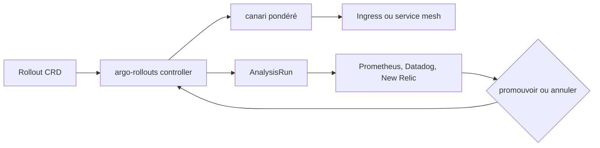

# argoproj/argo-rollouts

> Kubernetes controller adding blue-green and canary deployments and automated analysis.

## The problem
Kubernetes' `RollingUpdate` strategy offers no control over traffic or blast radius.
It can halt a progression, but cannot roll back on its own.

## What it actually does
CRDs that bring blue-green, canary, experimentation and progressive delivery.
Optional integration with ingress controllers and service meshes to shift traffic
gradually: NGINX, ALB, Apache APISIX, Istio, Linkerd, SMI.
Queries metric providers — Prometheus, Datadog, New Relic, InfluxDB, Kayenta, Kubernetes jobs —
to check indicators and decide by itself whether to promote or abort.

## How it is wired


## Trying it
```bash
kubectl create namespace argo-rollouts
kubectl apply -n argo-rollouts -f https://github.com/argoproj/argo-rollouts/releases/latest/download/install.yaml
```

## Cost and gotchas
Free, but you need a cluster and, for fine-grained traffic shifting, a compatible ingress or mesh.
Automated analysis assumes a reliable metrics source: a bad query promotes a bad version.

## What it is not
Not a replacement for Deployment everywhere: it targets high-volume environments where risk matters.
Not a GitOps tool — it works alongside Argo CD, it does not replace it.
Manual judgment remains a possible step: the automation is not total.

## Alternatives
No alternative named in the README.

## For you
Worth knowing if you put a model into production behind a service: metrics-driven canary applies well there.
