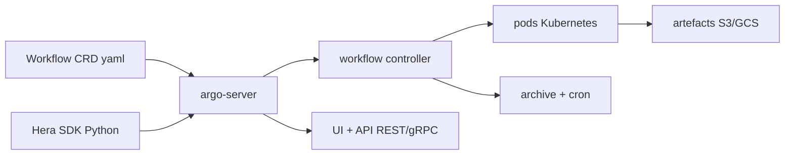

# argoproj/argo-workflows

> Containerized workflow engine on Kubernetes, each step is a container.

## The problem
Chaining long, parallel jobs on Kubernetes by hand means writing and
maintaining recovery, dependencies and artifact collection yourself.

## What it actually does
Installs as a Kubernetes CRD. You describe a workflow as sequential steps
or as a DAG of dependencies. Per-step inputs/outputs (artifacts or parameters),
loops, conditions, timeouts and retries at step and workflow level, suspend/resume,
memoization on resubmit. Artifacts to S3, Artifactory, Azure Blob, GCS, HTTP, Git.
Workflow templates stored in the cluster, archiving after execution, cron,
REST/gRPC API, OAuth2/OIDC SSO, Prometheus metrics, visualization UI.

## How it is wired

## Trying it
No installation command in the README: it points to the "Get started here"
of the documentation and to an online demo environment.

## Cost and gotchas
Free, graduated CNCF project. The real cost is the Kubernetes cluster and the object
storage for artifacts. No local execution without a cluster.

## What it is not
Not a general-purpose scheduler nor a data pipeline tool with table semantics:
it is container orchestration. No native Python interface —
it goes through Hera, a third-party project. AI-assisted contributions must
follow the Argo project's GenAI policy.

## Alternatives
- Kubeflow Pipelines: built on top of it, ML-oriented, more opinionated.
- Netflix Metaflow: also builds on it, Python API first.
- Kedro: structures the data code upstream rather than the execution.

## For you
The orchestration building block to know as soon as an ML pipeline runs on Kubernetes.
