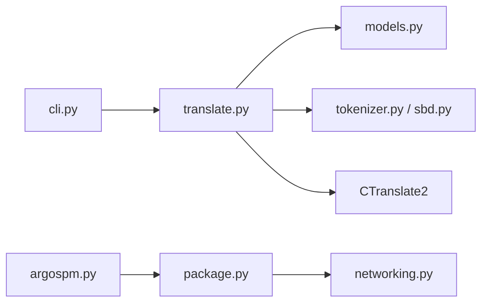

# argosopentech/argos-translate

> Offline machine translation Python library, based on OpenNMT and CTranslate2.

## The problem
Translating sensitive or bulk data through cloud APIs is expensive and sends the data out.

## What it actually does
Installs `.argosmodel` model packages per language pair and translates locally.
Automatic pivoting through an intermediate language (es → en → fr) when the direct pair is missing.
Pre/post-processing: tokenization, BPE, sentence splitting, tag preservation.
Python, CLI, separate GUI; optional GPU via `ARGOS_DEVICE_TYPE`. Foundation of LibreTranslate.

## How it is wired


## Trying it
```bash
pip install argostranslate
argospm update
argospm install translate-en_de
argos-translate --from en --to de "Hello World!"
```

## Cost and gotchas
Free, MIT; initial download of the models. Pivoting degrades quality.
Quality is lower than the big commercial services on some pairs.

## What it is not
Not an LLM: classic neural translation.
Not a web API (that is LibreTranslate).

## Alternatives
- LibreTranslate: API and web app built on top of it.
- translate-html, argos-translate-files: for HTML and files.

## For you
Adopt it to translate corpora locally in your NLP pipelines: lightweight, offline, permissive license.
