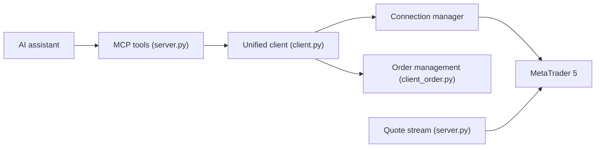

# ariadng/metatrader-mcp-server

> Bridge that lets an AI assistant read data and place orders on MetaTrader 5.

## The problem
Driving MetaTrader 5 (account, prices, orders, positions) by hand, with no natural-language interface or API an assistant can use.

## What it actually does
A Python library with a unified client, an MCP server (32 tools, stdio, SSE and HTTP transports), a FastAPI REST API and a WebSocket quote server. Operations: balance, prices, candles, market and pending orders, modifying and closing positions, history. A "trading" Claude skill is provided.

## How it is wired


## Trying it
```bash
pip install metatrader-mcp-server
metatrader-mcp-server --login YOUR_LOGIN --password YOUR_PASSWORD --server YOUR_SERVER --transport stdio
metatrader-quote-server --login YOUR_LOGIN --password YOUR_PASSWORD --server YOUR_SERVER
```

## Cost and gotchas
Free. You need Python 3.10+, an MT5 terminal and an account (demo or real). Credentials are passed on the command line or in `.env`. The MCP protocol has no authentication: the README recommends a firewall or an SSH tunnel.

## What it is not
It is not financial advice; the README disclaims all liability. The provided skill executes orders without additional confirmation.

## Alternatives
No named alternative in the README.

## For you
Ignore for real use: an agent that executes orders without confirmation on a real account is a disproportionate risk; test only on a demo account.
