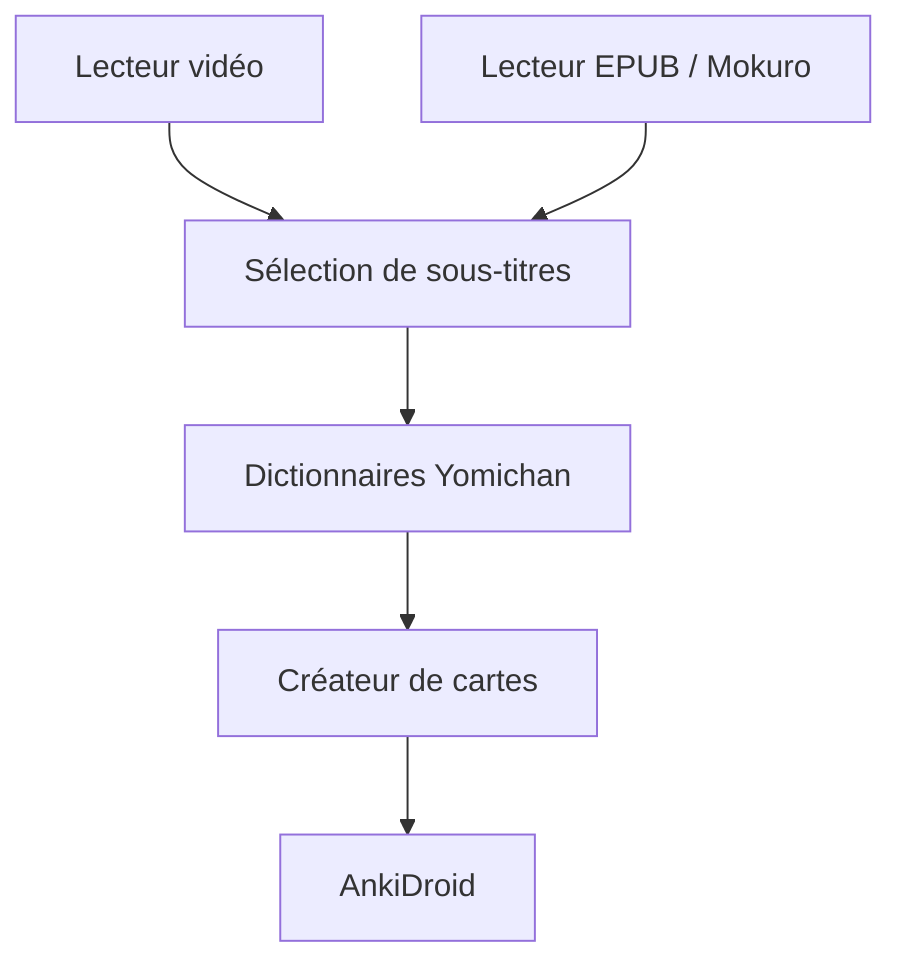

# arianneorpilla/jidoujisho

> Android app for learning Japanese: video player, dictionary and Anki card creation.

## The problem
Learning a language from media forces you to juggle a player, a dictionary and a flashcard tool.

## What it actually does
It plays local, YouTube or Jellyfin videos with subtitles, lets you tap a word for an instant lookup (Yomichan dictionaries), reads books through an embedded EPUB reader and manga processed by Mokuro. It exports cards with image and audio to AnkiDroid. It also includes a ChatGPT chat and WebSocket support for texthookers.

## How it is wired
Simplified diagram based on the sheet, no diagram supplied.

## Trying it
No command: download the latest release and install it on Android.

## Cost and gotchas
Free. The ChatGPT chat depends on a third-party service. The repository is archived (last push October 2025) with 144 open issues.

## What it is not
Not an active project: the repository is archived. The "Chisa" and "Yuuna" versions are cited as possible successors.

## Alternatives
The README cites related versions: Chisa and Yuuna.

## For you
Ignore: Japanese-learning app, archived, unrelated to your work.
