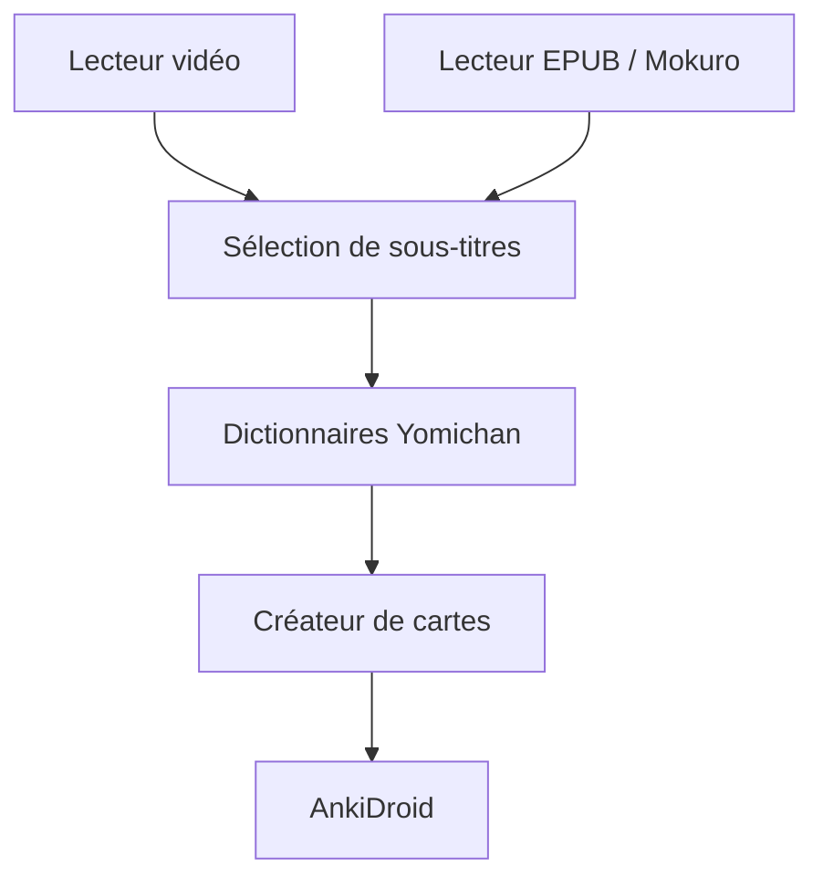

# arianneorpilla/jidoujisho

> Application Android pour apprendre le japonais : lecteur vidéo, dictionnaire et création de cartes Anki.

## Le problème
Apprendre une langue avec des médias oblige à jongler entre lecteur, dictionnaire et outil de flashcards.

## Ce que ça fait vraiment
Elle lit vidéos locales, YouTube ou Jellyfin avec sous-titres, permet de toucher un mot pour une recherche instantanée (dictionnaires Yomichan), lit des livres via un lecteur EPUB embarqué et des mangas traités par Mokuro. Elle exporte des cartes avec image et audio vers AnkiDroid. Elle intègre aussi un chat ChatGPT et un support WebSocket pour texthookers.

## Comment c'est branché
Schéma simplifié d'après la fiche, sans diagramme fourni.

## Essayer
Aucune commande : télécharger la dernière version et l'installer sur Android.

## Coût et pièges
Gratuit. Le chat ChatGPT dépend d'un service tiers. Le dépôt est archivé (dernier push octobre 2025) avec 144 issues ouvertes.

## Ce que ce n'est pas
Ce n'est pas un projet actif : le dépôt est archivé. Les versions « Chisa » et « Yuuna » sont citées comme successeurs possibles.

## Alternatives
Le README cite des versions apparentées : Chisa et Yuuna.

## Pour toi
À ignorer : application d'apprentissage du japonais, archivée, sans lien avec ton métier.

