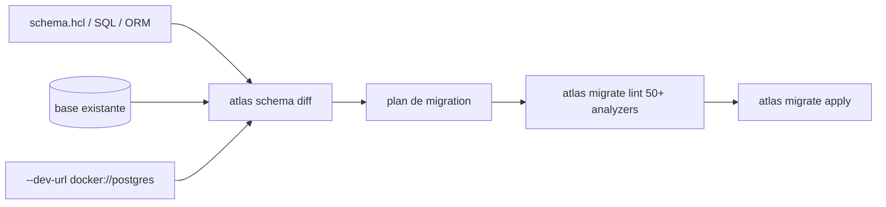

# ariga/atlas

> Database schema management as code, in declarative or versioned mode.

## The problem
Hand-written migrations drift from the real schema, and nothing warns that an `ALTER` will lock a table in production.

## What it actually does
Terraform-style declarative mode: compares the current state to the desired state (HCL, SQL or ORM) and generates the migration plan.
Versioned mode: plans, lints and applies migration files, with 16 ORM loaders across 6 languages.
More than 50 analyzers detect destructive changes, data-dependent modifications, locks and table rewrites.
Roles, permissions and row-level security declared in HCL; schema tests in `.test.hcl`; declarative seed data.

## How it is wired


## Trying it
```bash
brew install ariga/tap/atlas
atlas schema inspect -u "postgres://localhost:5432/mydb"
atlas migrate lint --dev-url "docker://postgres/16/dev"
atlas schema test --dev-url "docker://postgres/16/dev"
```

## Cost and gotchas
The `--dev-url` launches a throwaway database, in practice via Docker: plan for it in CI. The default installation offered is `curl -sSf https://atlasgo.sh | sh`; prefer Homebrew or the Docker image. The README mentions a cloud side (drift detection, IAM, secrets managers) without specifying its terms.

## What it is not
Not an ORM nor a SQL client: it manages the schema, not application queries. `schema apply` asks for interactive confirmation before executing — do not wire it into CI without precaution. The analyzers flag, they do not fix.

## Alternatives
No competitor named; the README only compares itself to Terraform for the declarative style.

## For you
The 50-analyzer migration lint alone justifies adoption as soon as you evolve a schema in production.
