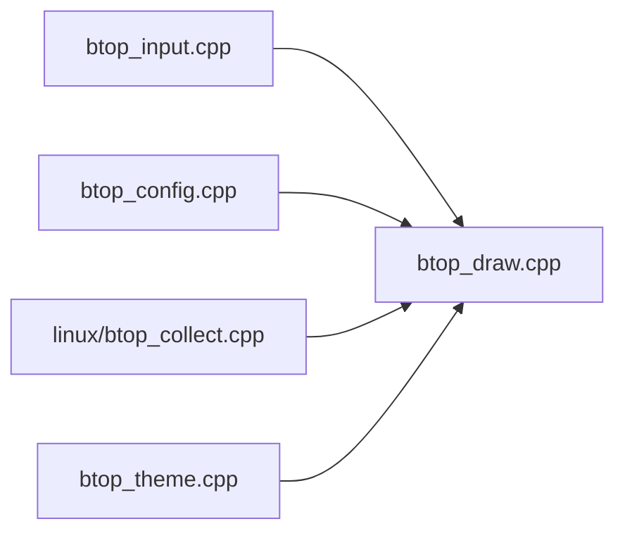

# aristocratos/btop

> Terminal resource monitor: processor, memory, disks, network, processes and GPU.

## The problem
See in real time what consumes CPU, memory, disk and network without leaving the terminal.

## What it actually does
Terminal interface with mouse support, graphs, filter and process tree, signal sending, themes, presets. Supports Linux, macOS, FreeBSD, NetBSD, OpenBSD; Nvidia, AMD and Intel GPUs (Intel and CPU power require `setcap` or `setuid`). C++ version of bashtop and bpytop.

## How it is wired
The diagram provided has no readable component. Based on the repository description:


## Trying it
```bash
brew install btop
sudo make install
sudo make setcap
make GPU_SUPPORT=false
```

## Cost and gotchas
Free. Building requires GCC 14 or Clang 19 minimum. GPU support does not work with static linking; the published binaries do not always include GPU.

## What it is not
Not a long-term monitoring tool: no history and no alerts. The README requires disclosing AI-written contributions.

## Alternatives
bpytop and bashtop: its predecessors, cited in the README; btop++ replaces them.

## For you
Worth watching: handy for tracking GPU and memory during a training run, but GPU support assumes a suitable build.
