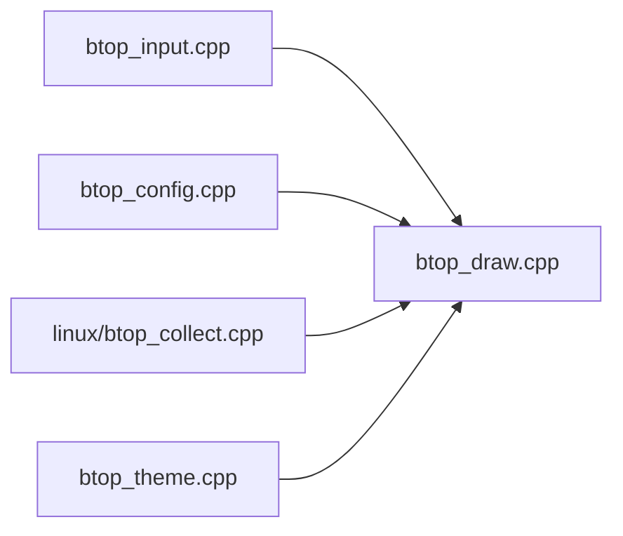

# aristocratos/btop

> Moniteur de ressources en terminal : processeur, mémoire, disques, réseau, processus et GPU.

## Le problème
Voir en temps réel ce qui consomme CPU, mémoire, disque et réseau sans quitter le terminal.

## Ce que ça fait vraiment
Interface en terminal avec souris, graphes, filtre et arbre des processus, envoi de signaux, thèmes, préréglages. Supporte Linux, macOS, FreeBSD, NetBSD, OpenBSD ; GPU Nvidia, AMD et Intel (Intel et la puissance CPU demandent `setcap` ou `setuid`). Version C++ de bashtop et bpytop.

## Comment c'est branché
Le diagramme fourni n'a aucun composant lisible. D'après la description du dépôt :


## Essayer
```bash
brew install btop
sudo make install
sudo make setcap
make GPU_SUPPORT=false
```

## Coût et pièges
Gratuit. Compilation : GCC 14 ou Clang 19 minimum. Le support GPU ne fonctionne pas en liaison statique ; les binaires publiés n'ont pas toujours le GPU.

## Ce que ce n'est pas
Pas un outil de supervision à long terme : pas d'historique ni d'alertes. Le README impose de signaler les contributions écrites par IA.

## Alternatives
bpytop et bashtop : ses prédécesseurs, cités dans le README ; btop++ les remplace.

## Pour toi
À surveiller : pratique pour suivre GPU et mémoire pendant un entraînement, mais le support GPU suppose une compilation adaptée.

