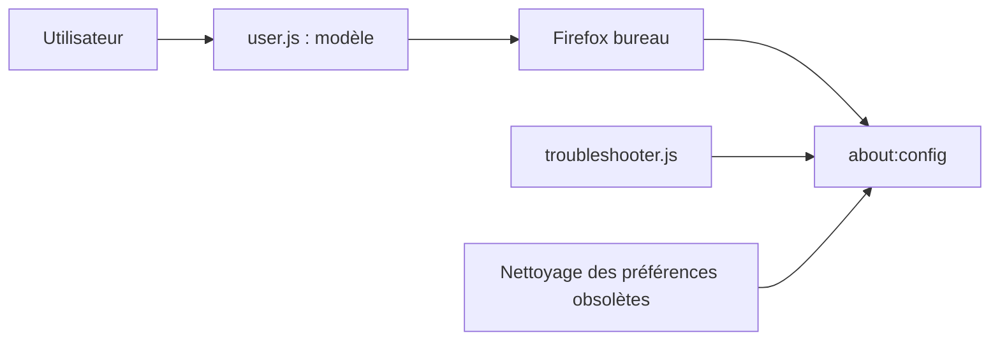

# arkenfox/user.js

> Template user.js file that hardens the privacy and security of desktop Firefox.

## The problem
Firefox's default settings leave tracking and fingerprinting in place; hardening them by hand in about:config is long.

## What it actually does
Provides a `user.js` to copy into the Firefox profile, which sets preferences aimed at reducing tracking, at the price of possible site breakage. A troubleshooting script helps isolate the faulty preference, another removes obsolete preferences. A wiki and an interactive page detail each setting.

## How it is wired

## Trying it
No command in the README: see the wiki and the releases.

## Cost and gotchas
Free. Site breakage is announced. Worth reading: the wiki, including for experts.

## What it is not
Not made for Tor Browser nor for other Gecko browsers. The README advises against Tor on Firefox. Only this repository and its page are official.

## Alternatives
- No alternative named in the README.

## For you
Keep an eye on it: useful for hardening a work browser, but with no link to a data/AI pipeline.
