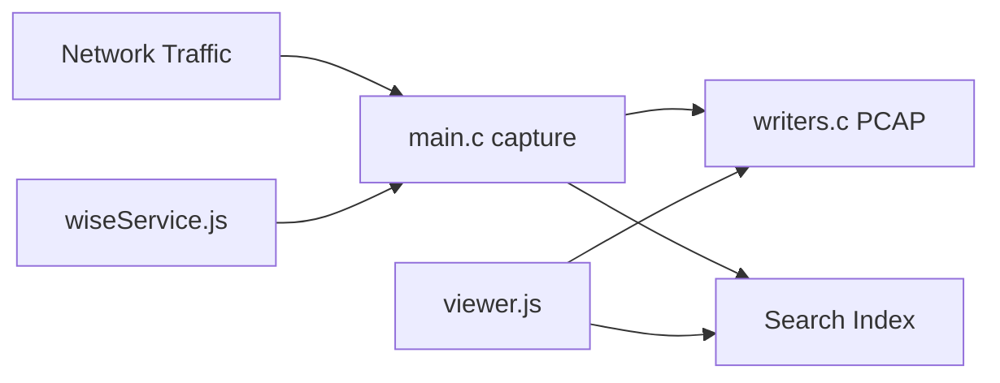

# arkime/arkime

> Large-scale network packet capture and indexing, with a web interface.

## The problem
Commercial full packet capture solutions are too expensive to cover every network.

## What it actually does
`capture` (C) listens to the traffic, writes PCAP to disk and sends session metadata to OpenSearch or Elasticsearch.
`viewer` (Node): web interface for search, SPI view and PCAP export, plus an API.
Optional: Cont3xt (context), WISE (threat intelligence), Parliament (multi-cluster), esProxy.
It scales up to tens of Gbit/s.

## How it is wired


## Trying it
```bash
git clone https://github.com/arkime/arkime
./easybutton-build.sh --install
make config
```

## Cost and gotchas
You need an OpenSearch or Elasticsearch cluster and plenty of disk on the sensors. Building from source is only recommended for advanced users.

## What it is not
Not an IDS: it complements one, it does not replace it.

## Alternatives
- Wireshark: for analyzing the exported PCAPs.

## For you
Ignore: this is network security tooling, outside the data, AI or MLOps scope.
