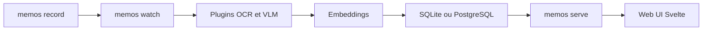

# arkohut/pensieve

> Passive, local screen recorder with full-text and vector search over the captures.

## The problem
Finding what you saw on screen last week without sending your captures to a third-party service, as Rewind or Windows Recall do.

## What it actually does
Captures the screen every 5 seconds, deduplicates, extracts text by OCR, computes embeddings and, optionally, describes the images with a VLM via Ollama. Storage in SQLite, or PostgreSQL with pgvector. Web interface on port 8839 and an agent skill that queries the search API.

## How it is wired


## Trying it
```bash
pip install memos
memos init
memos enable
memos start
memos doctor
```

## Cost and gotchas
About 400 MB of captures per day. The VLM requires an 8 GB NVIDIA GPU or an M-series Mac and increases consumption. On Mac, the screen recording permission must be renewed after a Python change. Windows: avoid the Store Python, WSL and OneDrive.

## What it is not
It is not encryption: the captures (passwords, banking) are stored in plain text in `~/.memos`. The pip package is called `memos` (the project's former name).

## Alternatives
No alternative in a repository; the README cites Rewind and Windows Recall, closed products.

## For you
Watch: well-designed local personal memory (OCR, embeddings, agent skill), but it captures everything that passes on screen, with a single maintainer.
