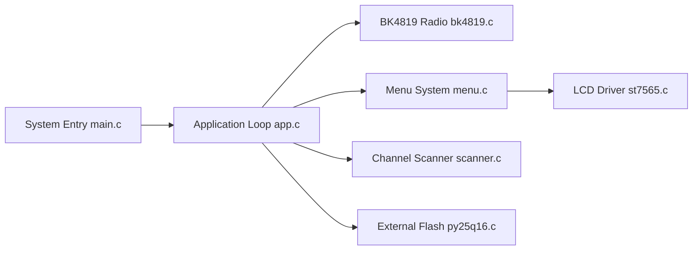

# armel/uv-k1-k5v3-firmware-custom

> Alternative F4HWN firmware for Quansheng UV-K1 and UV-K5 V3 radios, for amateur radio operators.

## The problem
The original firmware of these radios offers few features; the firmware port for the old microcontroller does not suit the recent models.

## What it actually does
Port to the PY32F071 microcontroller: spectrum analyzer, FM radio, VOX, RX/TX log, Full Watch, four editions (Fusion, Transfer, FieldOps, Labs), multiboot with four slots, AirCopy, UV Studio screen mirror, experimental overlay applications (APRS, ACARS, AIS, SSTV…). Built with Docker, flashed from the browser.

## How it is wired


## Trying it
```bash
./compile-firmware.sh
./compile-firmware.sh Fusion
./compile-firmware.sh Labs
```

## Cost and gotchas
Free, but there is a risk of bricking the radio, with no warranty. Back up the calibration with UV Studio right after flashing. Transmission is subject to your radio license.

## What it is not
Not a certified product: receive sensitivity remains limited by the radio's hardware. The Labs edition is experimental.

## Alternatives
Egzumer firmware and the original F4HWN (of which this repo is the fork).

## For you
Ignore: embedded amateur radio firmware, outside the data, AI or MLOps scope.
