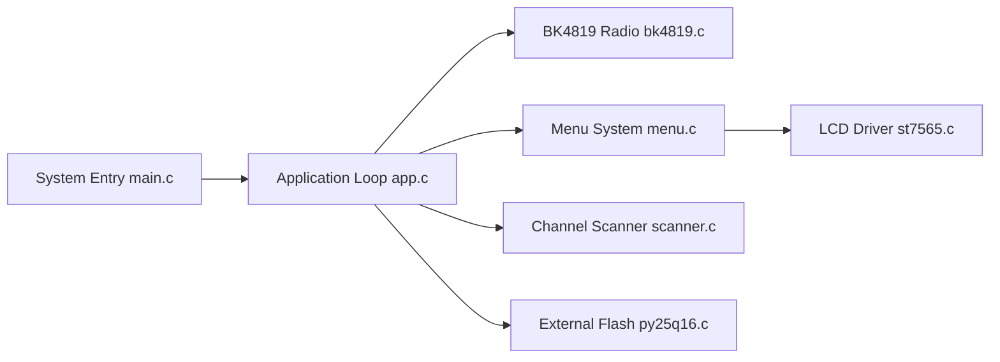

# armel/uv-k1-k5v3-firmware-custom

> Firmware F4HWN alternatif pour radios Quansheng UV-K1 et UV-K5 V3, pour radioamateurs.

## Le problème
Le firmware d'origine de ces radios offre peu de fonctions ; le portage du firmware pour l'ancien microcontrôleur ne convient pas aux modèles récents.

## Ce que ça fait vraiment
Portage vers le microcontrôleur PY32F071 : analyseur de spectre, radio FM, VOX, journal RX/TX, Full Watch, quatre éditions (Fusion, Transfer, FieldOps, Labs), multiboot avec quatre emplacements, AirCopy, miroir d'écran UV Studio, applications overlay expérimentales (APRS, ACARS, AIS, SSTV…). Compilation via Docker, flash depuis le navigateur.

## Comment c'est branché


## Essayer
```bash
./compile-firmware.sh
./compile-firmware.sh Fusion
./compile-firmware.sh Labs
```

## Coût et pièges
Gratuit, mais risque de briquer la radio, sans garantie. Sauvegarder la calibration avec UV Studio dès après le flash. Émission soumise à ta licence radio.

## Ce que ce n'est pas
Pas un produit certifié : la sensibilité de réception reste limitée par le matériel de la radio. L'édition Labs est expérimentale.

## Alternatives
Firmware Egzumer et F4HWN d'origine (dont le dépôt est le fork).

## Pour toi
À ignorer : firmware embarqué de radio amateur, hors du périmètre data, IA ou MLOps.

