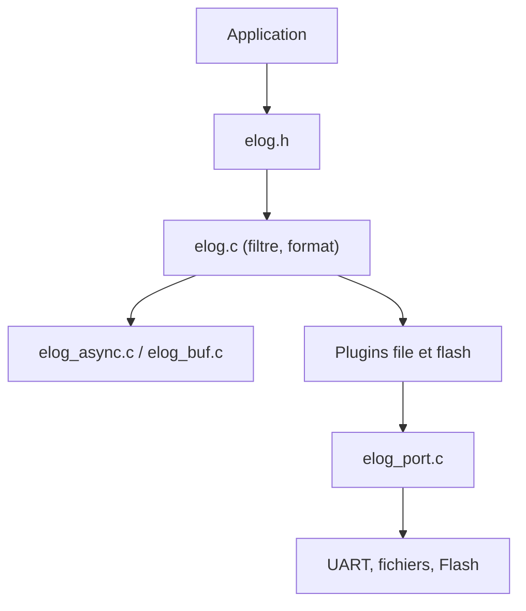

# armink/EasyLogger

> Ultra-lightweight C/C++ logging library for embedded systems and IoT.

## The problem
Well-known logging libraries (log4c, zlog) are too heavy for devices where ROM and RAM are counted byte by byte.

## What it actually does
It takes less than 1.6 KB of ROM and 0.3 KB of RAM. It filters by tag, level and keyword, formats level, time, thread and file, outputs synchronously, asynchronously or buffered, and offers RAW and hexdump output. Plugins add storage in Flash and in files with rotation. It adapts to RT-Thread, FreeRTOS, Linux, Windows, Nuttx or bare metal.

## How it is wired


## Trying it
```bash
# Aucune commande dans le README (en chinois) : lire docs/zh/port/kernel.md
# puis adapter elog_port.c ; démo dans demo/os/rt-thread/stm32f10x/.
```

## Cost and gotchas
Free. A port is needed for each target (elog_port.c); the configuration is a global singleton. The README is in Chinese.

## What it is not
It is not a monitoring or log collection tool: it is an embedded C library. Only one configuration per program.

## Alternatives
log4c and zlog, cited as richer but less simple to get started with.

## For you
Ignore: useful for embedded firmware, outside the scope of data, AI or MLOps work.
